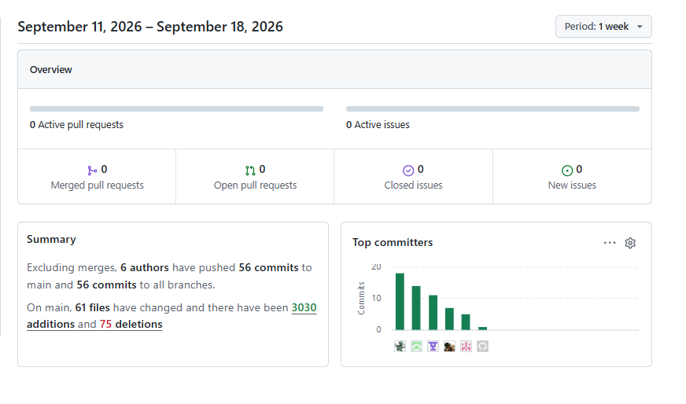
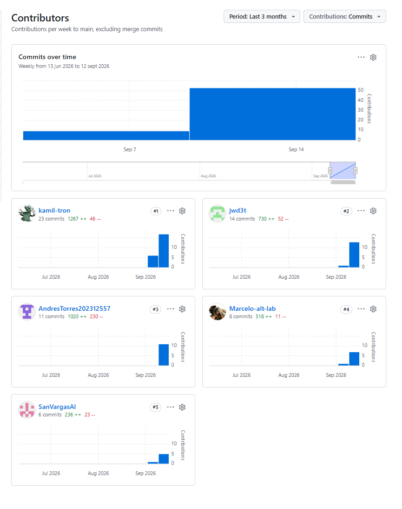
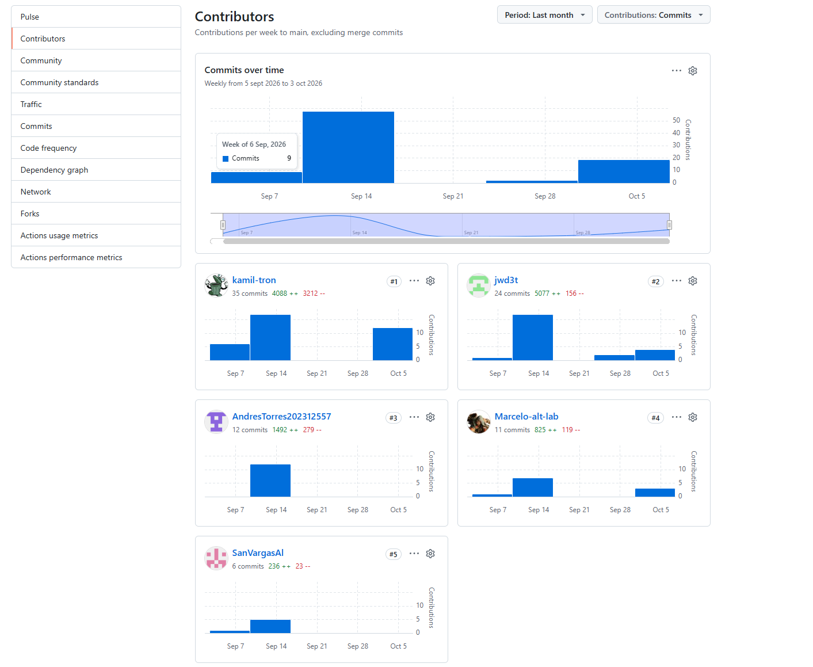
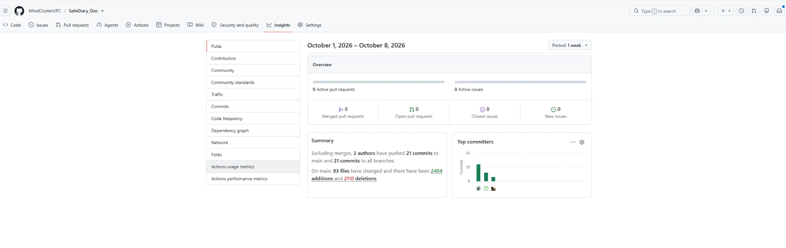

Universidad Peruana de Ciencias Aplicadas

Carrera de Ingeniería de Software

**1ACC0238**

**Aplicaciones para Dispositivos Móviles**

NRC

**4948**

**Informe del Trabajo Final**

Docente

**Eduardo Martin Reyes Rodriguez**

Equipo

**MindCluster**

Proyecto

**SafeDiary**

**Integrantes**

<table style="width: auto; border-collapse: collapse; text-align: center;">
  <thead>
    <tr>
      <th style="padding: 8px; border: 1px solid #666; text-align: center;">Código</th>
      <th style="padding: 8px; border: 1px solid #666; text-align: center;">Apellidos y nombres</th>
    </tr>
  </thead>
  <tbody>
    <tr>
      <td style="padding: 8px; border: 1px solid #666; text-align: center;">U202422890</td>
      <td style="padding: 8px; border: 1px solid #666; text-align: center;">Cuadros Villanueva, Marcelo Fabio</td>
    </tr>
    <tr>
      <td style="padding: 8px; border: 1px solid #666; text-align: center;">U202412316</td>
      <td style="padding: 8px; border: 1px solid #666; text-align: center;">Diaz Martinez, Alexther Kamil</td>
    </tr>
    <tr>
      <td style="padding: 8px; border: 1px solid #666; text-align: center;">U202312557</td>
      <td style="padding: 8px; border: 1px solid #666; text-align: center;">Torres Lavandera, Andres Rodrigo</td>
    </tr>
    <tr>
      <td style="padding: 8px; border: 1px solid #666; text-align: center;">U202416706</td>
      <td style="padding: 8px; border: 1px solid #666; text-align: center;">Vargas Alarcon, Santiago Enrique</td>
    </tr>
    <tr>
      <td style="padding: 8px; border: 1px solid #666; text-align: center;">U202318609</td>
      <td style="padding: 8px; border: 1px solid #666; text-align: center;">Wang Chen, Juan Sung Jau</td>
    </tr>
  </tbody>
</table>

**Período 2026-02**

**Noviembre 2026**

---

# Registro de Versiones del Informe

| Versión | Fecha | Autor(es) | Descripción de la modificación |
|:-------:|:-----:|-----------|--------------------------------|
| 0.0.1 | 11/09/2026 | Kamil Diaz | Creación del repositorio y estructura inicial, adición de contenido en el capitulo 1 |
| 0.0.2 | 11/02/2026 | Marcelo Cuadros | Añadir nombre de startup, imagen y contenido en la presentación de integrante |
| 0.0.3 | 13/09/2026 | Juan Wang | Redacción de la sección 1.1.1 Descripción de la Startup |
| 0.0.4 | 13/09/2026 | Juan Wang | Redacción de Lean UX Process (Problem Statement, Assumptions e Hypotheses) |
| 0.0.5 | 13/09/2026 | Juan Wang | Creación y formato de tabla para Lean UX Canvas |
| 0.0.6 | 15/09/2026 | Marcelo Cuadros | Complementar contenido de los segmentos objetivos, segmento 1.3, añadiendo fuentes en la bibliografia tambien para el registro de fuentes. |
| 0.0.7 | 17/09/2026 | Marcelo Cuadros | Añadir entrevista paciente 2 |
| 0.0.8 | 18/09/2026 | Andrés Torres | Añadir entrevista psicólogo 2 y empathy map |
| 0.0.9 | 18/09/2026 | Santiago Vargas | Añadir entrevista psicologo 3 y corrección de intregrantes de equipo |
| 0.0.10 | 18/09/2026 | Andrés Torres | Añadir Product Backlog |
| 0.0.11 | 18/09/2026 | Marcelo Cuadros | Añadir Analisis de entrevistas del primer segmento objetivo |
| 0.0.12 | 18/09/2026 | Marcelo Cuadros | Añadir Analisis de entrevistas del segundo segmento objetivo |
| 0.0.13 | 18/09/2026 | Juan Wang | Añadir User Journey Mapping de Pacientes y Psicólogos |
| 0.0.14 | 18/09/2026 | Juan Wang | Añadir Big Picture EventStorming, AssistantAI Canvas y Product Backlog de Trello |
| 0.0.15 | 18/09/2026 | Andrés Torres | Añadir Encabezados por Bounded Context |
| 0.0.16 | 18/09/2026 | Marcelo Cuadros | Completado del indice en el README.md | 
| 0.0.17 | 18/09/2026 | Marcelo Cuadros | Completado bounded context diary | 
| 0.0.18 | 18/09/2026 | Juan Wang | Añadir arquitectura de software C4 (Context y Container Diagrams) |
| 0.0.19 | 18/09/2026 | Marcelo Cuadros | Añadir el BC Diary Canvas |
| 0.0.20 | 18/09/2026 | Andrés Torres | Añadir el Bounded Context de IAM y Profiles y el Context Mapping |
| 0.0.21 | 18/09/2026 | Juan Wang | Añadir Candidate Context Discovery para los 7 Bounded Contexts |
| 0.0.22 | 18/09/2026 | Juan Wang | Añadir Domain Message Flows Modeling (flujos 1, 2 y 3) |
| 0.0.23 | 18/09/2026 | Juan Wang | Añadir Project Report Collaboration Insights |
| 0.0.24 | 18/09/2026 | Juan Wang | Añadir arquitectura de software C4 (Deployment Diagram) |
| 0.0.25 | 18/09/2026 | Juan Wang | Redacción de Conclusiones y Recomendaciones del proyecto |
| 0.0.26 | 18/09/2026 | Andrés Torres | Reestructuración de User Stories |
| 0.1.0 | 03/10/2026 | Juan Wang | Añadir la sección 4.1 Software Configuration Management y actualizar el índice del README |
| 0.1.1 | 06/10/2026 | Kamil Diaz | Actualizar Big Picture EventStorming, Candidate Context Discovery y Bounded Context Canvases de Clinician Directory, Care Scheduling y Payments & Payouts |
| 0.1.2 | 06/10/2026 | Kamil Diaz | Reemplazar diagramas C4, añadir flujo Directory–Scheduling–Payments, Impact Map de María, imágenes de bounded contexts y plantilla del capítulo 3 |
| 0.1.3 | 06/10/2026 | Juan Wang | Actualizar el diseño táctico de AssistantAI (2.6.3) a la implementación actual, con nuevos diagramas de componentes, clases y base de datos |
| 0.1.4 | 07/10/2026 | Marcelo Cuadros | Añadir Wireframes de los bounded contexts respectivos |
| 0.1.5 | 07/10/2026 | Juan Wang | Añadir los planes de suscripción Terra (mensual) y Astrum (anual) |
| 0.1.6 | 07/10/2026 | Juan Wang | Añadir Mobile Applications Wireflow Diagrams (wireflows 1 al 5) |
| 0.1.7 | 08/10/2026 | Kamil Diaz | Documentar historias de reseñas y moderación, Style Guidelines e Information Architecture |
| 0.1.8 | 08/10/2026 | Kamil Diaz | Añadir wireflow de calificación de la sesión y gestión de reseñas |
| 0.1.9 | 08/10/2026 | Marcelo Cuadros | Añadir mockup de Landing Page y Términos y Condiciones, y ordenar los Mock-ups móviles |
| 0.1.10 | 09/10/2026 | Juan Wang | Añadir User Flow Diagrams, reglas de seguridad del flujo y sección de Prototyping |
| 0.1.11 | 09/10/2026 | Juan Wang | Actualizar Registro de Versiones y Project Report Collaboration Insights del TB1 |
| 0.1.12 | 09/10/2026 | Juan Wang | Añadir Sprint Backlog 1, evidencias de desarrollo, pruebas, servicios y despliegue (backend v0.2.0 en Render), anexos y video del prototipo del paciente |
| 0.1.13 | 09/10/2026 | Marcelo Cuadros | Insights del Proyecto |
| 0.2.0 | 06/11/2026 | Juan Wang | Implementación del Bounded Context Diary en backend y móvil, auto-guardado silencioso y switch estilo Grok |
| 0.2.1 | 06/11/2026 | Juan Wang | Redacción de la sección 4.2.2 Sprint 2 (Sprint Planning, Backlog con Engineering Tasks de 4 a 8h, Evidencias y Servicios) para entrega AV2 |
| 0.2.2 | 12/11/2026 | Marcelo Cuadros | Actualización de portada, tabla de contenidos, Collaboration Insights, Student Outcome, conclusiones, bibliografía y anexos para AV2 (Sprint 2) |
| 0.2.3 | 12/11/2026 | Juan Wang | Corregir la sección 4.2.2 Sprint 2 con las historias, tareas, commits, pruebas y estado de despliegue reales; añadir 4.3 Validation Interviews y 4.4 Video About-the-Product |
| 0.2.4 | 13/11/2026 | Kamil Diaz | Corrección de repositorios y separación de las aplicaciones Android para pacientes y Flutter para psicólogos en arquitectura, configuración y anexos. |
| 0.2.5 | 13/11/2026 | Kamil Diaz | Incorporación de SafeDiary Clinical al Sprint 2 con alcance, incrementos, commits, contratos, capturas y verificación de 15 pruebas Flutter aprobadas. |

# Project Report Collaboration Insights

A continuación, se detalla el enlace al repositorio oficial del proyecto en GitHub, la metodología de trabajo colaborativo adoptada y la evidencia de las contribuciones realizadas durante la elaboración del informe:

- **Repositorio en GitHub:** [https://github.com/MindClusterUPC/SafeDiary_Doc](https://github.com/MindClusterUPC/SafeDiary_Doc)

### Resumen Consolidado de Contribuciones

| Integrante | Rol / Especialidad | Principales Aportes en el Informe |
| :--- | :--- | :--- |
| **Cuadros Villanueva, Marcelo Fabio** | Product & Domain Specialist | Segmentos objetivo, entrevistas a pacientes, análisis de entrevistas, Bounded Context Diary (DDD táctico, diagramas de clases, base de datos y componentes C4). |
| **Diaz Martinez, Alexther Kamil** | DevOps & Documentation Lead | Estructura del repositorio y configuración inicial, redacción de perfiles de startup, introducción y antecedentes. |
| **Torres Lavandera, Andres Rodrigo** | Systems Architect & Backend Dev | Entrevistas y empathy map de psicólogos, Product Backlog inicial, Bounded Contexts IAM & Profiles, Context Mapping DDD. |
| **Vargas Alarcon, Santiago Enrique** | Domain Specialist & QA | Entrevistas a psicólogos, refinamiento de perfiles de integrantes, Bounded Context Rutines (DailyCare). |
| **Wang Chen, Juan Sung Jau** | Lead Architect & UX Analyst | Lean UX Process (Problem Statements, Assumptions, Hypotheses, Lean UX Canvas), Journey Maps, Big Picture EventStorming, Arquitectura C4 (Context y Container Diagrams), Candidate Context Discovery y Domain Message Flows. |

### Entrega TB1 (19/09/2026 – 09/10/2026)

Durante el TB1 el trabajo se distribuyó en cuatro repositorios de la organización [MindClusterUPC](https://github.com/MindClusterUPC):

| Repositorio | Contenido |
| :--- | :--- |
| [SafeDiary_Doc](https://github.com/MindClusterUPC/SafeDiary_Doc) | Informe del proyecto |
| [SafeDiary_Landing_Page](https://github.com/MindClusterUPC/SafeDiary_Landing_Page) | Landing Page |
| [SafeDiary-Android](https://github.com/MindClusterUPC/SafeDiary-Android) | Aplicación móvil Android (Kotlin, Jetpack Compose) |
| [safediary-platform](https://github.com/MindClusterUPC/safediary-platform) | Backend RESTful (Spring Boot) |

| Integrante | Principales aportes en el TB1 |
| :--- | :--- |
| **Cuadros Villanueva, Marcelo Fabio** | Wireframes por bounded context, mockups de Landing Page y Términos y Condiciones, orden de los Mock-ups móviles; desarrollo de la Landing Page y del bounded context Profiles en el backend. |
| **Diaz Martinez, Alexther Kamil** | Actualización de EventStorming, Candidate Context Discovery, Bounded Context Canvases y diagramas C4; historias de reseñas y moderación; Style Guidelines, Information Architecture y wireflow de reseñas; rediseño de la Landing Page. |
| **Torres Lavandera, Andres Rodrigo** | Desarrollo del bounded context Care Scheduling en el backend: modelo de dominio de solicitudes, citas y sesiones, servicios CQRS, persistencia JPA, adaptadores ACL con Clinician Directory y Payments, controladores REST, pruebas de dominio e integración y documentación de endpoints. |
| **Vargas Alarcon, Santiago Enrique** | Desarrollo del bounded context Rutines en el backend: capas de dominio, aplicación, infraestructura e interfaces REST, con sus pruebas. |
| **Wang Chen, Juan Sung Jau** | Software Configuration Management (4.1), diseño táctico de AssistantAI, planes Terra y Astrum, Wireflows, User Flow Diagrams y Prototyping; desarrollo de la aplicación móvil (Diarito, caché offline, navegación) y del backend AssistantAI desplegado en Render; sección de planes de la Landing Page. |

### Entrega AV2 – Sprint 2 (10/10/2026 – 12/11/2026)

Durante el AV2 (Sprint 2) el equipo consolidó la implementación de los flujos nucleares en el backend (`safediary-platform`), la aplicación móvil nativa (`SafeDiary-Android`), la Landing Page (`SafeDiary_Landing_Page`) y la documentación del Sprint 2 en `SafeDiary_Doc`:

| Integrante | Principales aportes en el AV2 (Sprint 2) |
| :--- | :--- |
| **Cuadros Villanueva, Marcelo Fabio** | Backend de Profiles (actualización de perfil, contacto de emergencia y cambio de correo con verificación de contraseña) y de Payments (Stripe Connect con destination charges y webhooks, historial de pagos y métodos guardados); en la app, flujo de autenticación, gestión de perfil, pagos y navegación por pestañas (US-001, US-006, US-037); actualización de portada, Student Outcome, conclusiones, bibliografía y anexos del informe. |
| **Diaz Martinez, Alexther Kamil** | Vistas del paciente en la app: check-in de ánimo, directorio y ficha de psicólogos, solicitud de contacto y chat de coordinación, rutinas y ejercicios (US-010, US-002, US-048, US-007); persistencia de rutinas editables en el backend, horarios flexibles, aislamiento del historial heredado de Diarito, fotos de perfil y recuperación de sesiones inválidas. |
| **Torres Lavandera, Andres Rodrigo** | Bounded Context IAM en el backend (dominio de cuentas y consentimientos, seguridad JWT, BCrypt, controladores y pruebas de integración) e integración de Care Scheduling con IAM; en la app, carga del directorio desde la API y conexión de Care Scheduling con el backend (US-001, US-002, US-014, US-043, US-049). |
| **Vargas Alarcon, Santiago Enrique** | Conexión de las rutinas de autocuidado y de los ejercicios SOS de la app con el backend de Rutines, y sus pruebas de conexión (US-007, US-030). |
| **Wang Chen, Juan Sung Jau** | Bounded Context Diary en backend y app (agregado `DiaryEntry`, JPA, Room offline-first, galería de notas y editor de diario con formato visual y preguntas guía); varias sesiones de Diarito por cuenta; restricción de todos los endpoints a la cuenta autenticada y aislamiento de datos locales por cuenta; pruebas Karate autenticadas; releases `v0.3.0` y `v0.4.0` del backend y migración de la base de datos de producción a Neon; redacción de la sección 4.2.2, 4.3 y 4.4 del informe (US-001, US-008, US-011, US-013). |

---

### Entrega AV2 y aplicación profesional Flutter

En la actualización del Sprint 2 se incorpora el quinto repositorio de la solución, [SafeDiary_Flutter](https://github.com/MindClusterUPC/SafeDiary_Flutter), para la aplicación de psicólogos. Kamil Diaz documenta sus módulos de Agenda, Pacientes y Pagos, la ficha profesional, los contratos del backend y los límites de privacidad y cobros. La sección 4.2.2 incluye los commits de implementación del 9 al 12 de noviembre, cinco capturas del entorno de prueba y la ejecución del 13 de noviembre con 15 pruebas Flutter aprobadas. Las aplicaciones del paciente y del profesional se describen como clientes separados del mismo backend.

# Tabla de contenidos

- Capítulo I: Presentación
  - 1.1. Startup Profile
    - 1.1.1. Descripción de la Startup
    - 1.1.2. Perfiles de integrantes del equipo
  - 1.2. Solution Profile
    - 1.2.1. Antecedentes y problemática
    - 1.2.2. Lean UX Process
      - 1.2.2.1. Lean UX Problem Statements
      - 1.2.2.2. Lean UX Assumptions
      - 1.2.2.3. Lean UX Hypothesis Statements
      - 1.2.2.4. Lean UX Canvas
  - 1.3. Segmentos objetivo
- Capítulo II: Requirements Development and Software Solution Design
  - 2.1. Competidores
    - 2.1.1. Análisis competitivo
    - 2.1.2. Estrategias y tácticas frente a competidores
  - 2.2. Entrevistas
    - 2.2.1. Diseño de entrevistas
    - 2.2.2. Registro de entrevistas
    - 2.2.3. Análisis de entrevistas
  - 2.3. Needfinding
    - 2.3.1. User Personas
    - 2.3.2. User Task Matrix
    - 2.3.3. User Journey Mapping
    - 2.3.4. Empathy Mapping
    - 2.3.5. Big Picture EventStorming
    - 2.3.6. Ubiquitous Language
  - 2.4. Requirements specification
    - 2.4.1. User Stories
    - 2.4.2. Impact Mapping
    - 2.4.3. Product Backlog
  - 2.5. Strategic-Level Domain-Driven Design
    - 2.5.1. EventStorming
      - 2.5.1.1. Candidate Context Discovery
      - 2.5.1.2. Domain Message Flows Modeling
      - 2.5.1.3. Bounded Context Canvases
    - 2.5.2. Context Mapping
    - 2.5.3. Software Architecture
      - 2.5.3.1. Software Architecture Context Level Diagrams
      - 2.5.3.2. Software Architecture Container Level Diagrams
      - 2.5.3.3. Software Architecture Deployment Diagrams
  - 2.6. Tactical-Level Domain-Driven Design
    - 2.6.x. Bounded Context: &lt;Bounded Context Name&gt;
      - 2.6.x.1. Domain Layer
      - 2.6.x.2. Interface Layer
      - 2.6.x.3. Application Layer
      - 2.6.x.4. Infrastructure Layer
      - 2.6.x.5. Bounded Context Software Architecture Component Level Diagrams
      - 2.6.x.6. Bounded Context Software Architecture Code Level Diagrams
        - 2.6.x.6.1. Bounded Context Domain Layer Class Diagrams
        - 2.6.x.6.2. Bounded Context Database Design Diagram
- Capítulo III: Solution UI/UX Design
  - 3.1. Product design
    - 3.1.1. Style Guidelines
      - 3.1.1.1. General Style Guidelines
    - 3.1.2. Information Architecture
      - 3.1.2.1. Organization Systems
      - 3.1.2.2. Labelling Systems
      - 3.1.2.3. SEO Tags and Meta Tags
      - 3.1.2.4. Searching Systems
      - 3.1.2.5. Navigation Systems
    - 3.1.3. Landing Page UI Design
      - 3.1.3.1. Landing Page Wireframe
      - 3.1.3.2. Landing Page Mock-up
    - 3.1.4. Mobile Applications UX/UI Design
      - 3.1.4.1. Mobile Applications Wireframes
      - 3.1.4.2. Mobile Applications Wireflow Diagrams
      - 3.1.4.3. Mobile Applications Mock-ups
      - 3.1.4.4. Mobile Applications User Flow Diagrams
      - 3.1.4.5. Mobile Applications Prototyping
- Capítulo IV: Product Implementation & Validation
  - 4.1. Software Configuration Management
    - 4.1.1. Software Development Environment Configuration
    - 4.1.2. Source Code Management
    - 4.1.3. Source Code Style Guide & Conventions
    - 4.1.4. Software Deployment Configuration
  - 4.2. Landing Page & Mobile Application Implementation
    - 4.2.1. Sprint 1
    - 4.2.2. Sprint 2
  - 4.3. Validation Interviews
    - 4.3.1. Diseño de Entrevistas
    - 4.3.2. Registro de Entrevistas
    - 4.3.3. Evaluaciones según heurísticas
  - 4.4. Video About-the-Product
- Conclusiones
- Recomendaciones
- Bibliografía
- Anexos

# Student Outcome

Cada participante del equipo sustenta evidencia de cómo las actividades realizadas en el trabajo final han ayudado a desarrollar las dimensiones del student outcome. Por ello, en esta sección se describe por escrito la relación entre el outcome, sus dimensiones y el trabajo que ha realizado cada integrante durante el **Avance 1 (AV1)**, la **entrega TB1** y el **Avance 2 (AV2)**. Esto se complementa con lo reflejado en los testimonios expuestos que forman parte del video *About The Team*.

El curso contribuye al cumplimiento del Student Outcome ABET:

### ABET - EAC - Student Outcome 7

**Criterio:** *La capacidad de adquirir y aplicar nuevos conocimientos según sea necesario, utilizando estrategias de aprendizaje apropiadas.*

En el siguiente cuadro se describen las acciones realizadas y enunciados de conclusiones por parte del grupo, que permiten sustentar el haber alcanzado el logro del ABET – EAC - Student Outcome 7 durante el Avance 1 (AV1), la entrega TB1 y el Avance 2 (AV2).

| Criterio específico | Acciones realizadas | Conclusiones |
|---|---|---|
| Actualiza conceptos y conocimientos necesarios para su desarrollo profesional y en especial para su proyecto en soluciones de software. | **Diaz Martinez, Alexther Kamil:** *AV1:* Diseñé las preguntas semiestructuradas de entrevista para los segmentos de pacientes jóvenes y psicólogos profesionales, ejecuté las primeras entrevistas de cada segmento y estructuré el repositorio inicial del proyecto; esto me permitió aplicar técnicas de user research y needfinding en un contexto real de bienestar emocional. *TB1:* Actualicé el EventStorming, el Candidate Context Discovery, los Bounded Context Canvases y los diagramas C4 a los ocho contextos vigentes; definí las Style Guidelines y la Information Architecture, rediseñé la Landing Page e implementé el bounded context Clinician Directory en el backend (verificación, fichas, tarifas versionadas y reseñas con pruebas de integración); esto me permitió aplicar Spring Boot y JPA en un contexto con reglas de acceso y concurrencia. *AV2:* Coordiné la revisión del Sprint 2 y el alineamiento de los contextos documentados frente a los incrementos implementados en backend y móvil, asegurando trazabilidad entre historias de usuario, backlog y arquitectura.  **Cuadros Villanueva, Marcelo Fabio:** *AV1:* Complementé los segmentos objetivo con fuentes académicas (Senaju, Minsa, CPSP, INSM), conduje y analicé las entrevistas de ambos segmentos objetivo, y desarrollé el diseño táctico completo del Bounded Context Diary (Domain Layer, Interface Layer, Application Layer e Infrastructure Layer); esto me permitió aplicar Domain-Driven Design y fundamentar decisiones de producto con evidencia empírica y académica. *TB1:* Elaboré los wireframes por bounded context y los mockups de la Landing Page y de Términos y Condiciones, desarrollé la Landing Page modular con i18n e implementé en el backend los bounded contexts Profiles y Payments & Payouts, integrando la pasarela Stripe mediante un adaptador ACL; esto me permitió aplicar el diseño de interfaces y la integración con servicios de pago externos. *AV2:* Implementé los endpoints REST y vistas móviles para gestión de perfil, contacto de emergencia y cambio de correo con verificación de contraseña (US-006), el historial de pagos y métodos guardados con Stripe Connect (US-037), y la navegación horizontal `MainTabPagerScreen` con soporte Edge-to-Edge (US-033).  **Torres Lavandera, Andrés Rodrigo:** *AV1:* Elaboré el Product Backlog priorizado combinando valor de negocio y estimación por Planning Poker, diseñé los Bounded Contexts IAM y Profiles con sus capas de dominio, interfaz, aplicación e infraestructura, construí el Context Mapping estratégico aplicando los patrones DDD (Open Host Service, Anticorruption Layer, Customer/Supplier, Published Language) y elaboré los diagramas de arquitectura en Structurizr DSL y Mermaid; esto me permitió aplicar de forma práctica los conceptos de Domain-Driven Design estratégico y táctico, y de gestión ágil de producto. *TB1:* Implementé el bounded context Care Scheduling en el backend: modelo de dominio de solicitudes, citas y sesiones, servicios CQRS, persistencia JPA, adaptadores ACL con Clinician Directory y Payments, controladores REST y pruebas de dominio e integración; esto me permitió llevar a código los patrones de integración entre contextos que había diseñado en AV1. *AV2:* Configuré la seguridad JWT en el backend, los filtros de autenticación, los servicios de login/registro y la protección de endpoints privados con cierre de sesión (US-001), fortaleciendo la arquitectura de seguridad del sistema.  **Vargas Alarcón, Santiago Enrique:** *AV1:* Entrevisté a una psicóloga clínica del segundo segmento objetivo y corregí la información de los integrantes del equipo en la documentación; esto me permitió aplicar técnicas de entrevista a profesionales de salud mental y contrastar sus necesidades clínicas con la propuesta de producto. *TB1:* Elaboré los wireframes y el wireflow del bounded context Rutines e implementé ese contexto en el backend con sus capas de dominio, aplicación, infraestructura e interfaces REST y sus pruebas; esto me permitió aplicar por primera vez una arquitectura por capas con Spring Boot. *AV2:* Integré el selector de estado anímico (*Mood Check-in*) en la pantalla principal de la aplicación móvil con registro temporal (US-010), conectando el seguimiento emocional diario con el flujo del paciente.  **Wang Chen, Juan Sung Jau:** *AV1:* Redacté la descripción de la startup, el proceso completo de Lean UX (Problem Statements, Assumptions, Hypothesis Statements y Lean UX Canvas), elaboré el User Journey Mapping con la rueda de emociones de Plutchik, modelé el Big Picture EventStorming y el Bounded Context Canvas de AssistantAI, y configuré la importación del Product Backlog a Trello; esto me permitió aplicar Lean UX y EventStorming como metodologías de descubrimiento de producto y diseño estratégico de dominio. *TB1:* Documenté el Software Configuration Management, los Wireflows, User Flow Diagrams y el Prototyping; desarrollé la aplicación móvil en Kotlin con Jetpack Compose (chat con Diarito, historial, personalidades, caché offline con Room) y el backend de AssistantAI desplegado en Render con Docker, y armé la suite de pruebas con JUnit, Mockito, Karate, JaCoCo y Jenkins; esto me permitió integrar diseño, desarrollo móvil, despliegue en la nube y pruebas automatizadas. *AV2:* Implementé de extremo a extremo el Bounded Context Diary en backend y Android con arquitectura offline-first (Room SQLite v2 + PostgreSQL), editor Markdown con vista previa en vivo, auto-guardado debounced a 1500 ms, galería de 2 columnas, switch estilo Grok, múltiples sesiones de Diarito, pruebas unitarias y documentación del Sprint 2. | En AV1, el equipo evidenció la actualización de conocimientos al aplicar entrevistas cualitativas, Lean UX, Domain-Driven Design estratégico y táctico (EventStorming, Bounded Context Canvases, Context Mapping), gestión ágil del Product Backlog y modelado C4 con Structurizr, materializando estos conceptos en los entregables concretos del Capítulo II del proyecto SafeDiary. En TB1, el equipo aplicó estos conocimientos al diseño de experiencia (wireframes, wireflows y prototipos) y a la implementación de la Landing Page, la aplicación móvil y seis bounded contexts del backend desplegados en Render. En AV2, el equipo consolidó la integración móvil-backend con autenticación JWT, perfil clínico, pagos Stripe Connect, check-in emocional y diario en Markdown offline-first. |
| Reconoce la necesidad del aprendizaje permanente para el desempeño profesional y el desarrollo de proyectos en soluciones de software. | **Diaz Martinez, Alexther Kamil:** *AV1:* Investigué técnicas de diseño de preguntas semiestructuradas para minimizar el sesgo del entrevistador al abordar un tema sensible como la salud mental, profundizando en metodologías de entrevista cualitativa que no había aplicado previamente. *TB1:* Investigué cómo verificar acciones concurrentes sobre reseñas y cómo mantener coherentes los diagramas C4 al cambiar el mapa de contextos, revisando la documentación de Spring y del C4 Model. *AV2:* Profundicé en prácticas de revisión técnica de entregas incrementales y trazabilidad entre historias de usuario, tareas de ingeniería y criterios ABET.  **Cuadros Villanueva, Marcelo Fabio:** *AV1:* Profundicé en el análisis cualitativo de entrevistas para sintetizar patrones entre participantes distintos, y aprendí a modelar un Bounded Context completo bajo DDD táctico, un enfoque de arquitectura que no había aplicado antes en un proyecto de este tamaño. *TB1:* Aprendí a usar la API de Stripe (suscripciones, checkout y webhooks firmados) y a aislarla detrás de un Anticorruption Layer, una integración que no había realizado antes. *AV2:* Aprendí sobre Stripe Connect (*destination charges* y doble secreto de webhook) y manejo de insets dinámicos Edge-to-Edge en Jetpack Compose para pantallas con teclado y barra de navegación.  **Torres Lavandera, Andrés Rodrigo:** *AV1:* Investigué y apliqué por primera vez el modelado C4 con Structurizr DSL y los patrones de relación entre Bounded Contexts (Shared Kernel, Conformist, Anticorruption Layer, Customer/Supplier), contrastando distintas alternativas de diseño mediante preguntas de exploración ("¿qué pasaría si...?") antes de decidir la arquitectura final; esto fortaleció mi capacidad de evaluar trade-offs arquitectónicos de forma crítica. *TB1:* Investigué cómo modelar reservas temporales con vencimiento y la coordinación entre contextos sin compartir bases de datos, contrastando alternativas antes de implementar el flujo de citas. *AV2:* Profundicé en la implementación de seguridad basada en tokens JWT en Spring Security, interceptores de autorización y estrategias de cierre de sesión seguro.  **Vargas Alarcón, Santiago Enrique:** *AV1:* Profundicé en el marco ético y normativo de la telepsicología en el Perú (lineamientos del Colegio de Psicólogos del Perú) para poder formular preguntas de entrevista pertinentes al ejercicio profesional, un tema que no había investigado previamente. *TB1:* Aprendí la estructura de un proyecto Spring Boot con DDD (agregados, repositorios, servicios de comandos y consultas) para implementar mi primer bounded context completo. *AV2:* Aprendí a diseñar e integrar componentes reactivos de registro emocional rápido en Jetpack Compose conectados con series temporales.  **Wang Chen, Juan Sung Jau:** *AV1:* Aprendí y apliqué por primera vez la técnica de Big Picture EventStorming y la rueda de emociones de Plutchik para estructurar journey maps emocionalmente precisos, ampliando mi conjunto de herramientas de análisis de experiencia de usuario más allá de lo visto en clase. *TB1:* Aprendí por mi cuenta Room para el modo offline, el despliegue de contenedores Docker en Render y herramientas de prueba como Karate y JaCoCo, consultando su documentación oficial para aplicarlas al proyecto. *AV2:* Investigué migraciones de esquemas en Room SQLite, estrategias de auto-guardado *debounced* sin fricción clínica y renderizado nativo de Markdown en Jetpack Compose. | En AV1, el equipo demostró aprendizaje permanente al investigar y adoptar por primera vez técnicas y herramientas no cubiertas previamente en el curso —como el modelado C4/Structurizr, la rueda de emociones de Plutchik, el análisis normativo de telepsicología y los patrones de relación entre Bounded Contexts—, transfiriendo este conocimiento entre los integrantes del equipo para elevar la calidad técnica del trabajo colaborativo. En TB1, cada integrante aprendió de forma autónoma tecnologías nuevas para implementar su parte (Stripe, Room, Docker, Karate, JPA con concurrencia) y las compartió mediante revisiones de pull requests. En AV2, el equipo profundizó de manera autónoma en seguridad JWT, Stripe Connect, migraciones Room, renderizado Markdown y diseño Edge-to-Edge en Android. |

