# Capítulo IV: Product Implementation & Validation

---

## 4.1. Software Configuration Management

Para garantizar un proceso de ingeniería de software estructurado, colaborativo y sin fricciones durante el desarrollo del ecosistema **SafeDiary**, el equipo **MindCluster** ha definido la estrategia de Gestión de Configuración del Software (SCM). Este marco establece la homologación del entorno de desarrollo, la administración distribuida del código fuente bajo el flujo de trabajo GitFlow, las guías de estilo para asegurar la mantenibilidad del código base y la configuración de los despliegues en entornos de producción en la nube.

---

### 4.1.1. Software Development Environment Configuration

Con la finalidad de optimizar la productividad y garantizar la compatibilidad entre todos los miembros del equipo a lo largo del ciclo de vida del proyecto, se seleccionaron herramientas especializadas de nivel industrial. La elección responde a criterios de compatibilidad multiplataforma, soporte a estándares abiertos y alineación con metodologías ágiles (Scrum/Kanban).

| Categoría | Herramienta | Versión / Plataforma | Propósito en el Proyecto | Enlace Oficial / Acceso |
| :--- | :--- | :--- | :--- | :--- |
| **Project Management** | Trello | Web / Cloud | Gestión y seguimiento del Product Backlog y Sprint Backlog mediante tablero Kanban (`To Do`, `In Process`, `To Review`, `Done`). | [Trello Backlog](https://trello.com/b/Q2UsNz3t/product-backlog) |
| **Requirements & Needfinding** | UXPressia / Miro | Web / Cloud | Construcción y documentación colaborativa de User Personas, Empathy Maps, Journey Maps y EventStorming de Dominio. | [Miro Platform](https://miro.com/) |
| **UX/UI Design & Prototyping** | Figma | Cloud Desktop v124+ | Diseño del Design System, Style Guidelines, Wireframes, Wireflows y Prototipo Interactivo de Alta Fidelidad para Mobile y Landing Page. | [Figma SafeDiary](https://figma.com) |
| **Architecture Modeling** | Structurizr / Mermaid | Web DSL / Markdown | Modelado de diagramas de arquitectura C4 (Context, Container, Component, Deployment) y diagramas ER de persistencia relacional. | [Structurizr](https://structurizr.com/) |
| **Mobile Development** | Android Studio / VS Code | Iguana / Hedgehog | Entorno de desarrollo para la aplicación móvil cliente en Flutter/Dart y Android nativo, emuladores y profiling. | [Android Studio](https://developer.android.com/studio) |
| **Backend Development** | IntelliJ IDEA Ultimate | 2024.1+ / Community | Desarrollo del backend RESTful API en Java 21 con Spring Boot 4.x / 3.x, Maven y soporte para arquitectura Domain-Driven Design (DDD). | [JetBrains IntelliJ](https://www.jetbrains.com/idea/) |
| **Database Engine & GUI** | PostgreSQL 15 & pgAdmin 4 | v15.4+ / Cloud | Motor de base de datos relacional para persistencia de cuentas, registros de humor, entradas íntimas y catalogo de rutinas. | [PostgreSQL](https://www.postgresql.org/) |
| **API Testing & Verification** | Postman / Bruno | Desktop v11+ | Diseño de colecciones de pruebas automatizadas, validación de contratos JSON, endpoints REST y autenticación por tokens JWT. | [Postman](https://www.postman.com/) |
| **Version Control & Collaboration** | GitHub | Git v2.50+ | Alojamiento distribuido del código fuente, revisiones por pares (Peer Code Reviews), Pull Requests y seguimiento de incidencias. | [GitHub MindCluster](https://github.com/MindClusterUPC) |
| **Docs-as-Code** | Markdown & Pandoc | GFM / Pandoc 3+ | Redacción y versionado del informe técnico del proyecto bajo filosofía Docs-as-Code con exportación automatizada a PDF. | [SafeDiary_Doc Repo](https://github.com/MindClusterUPC/SafeDiary_Doc) |

---

### 4.1.2. Source Code Management

El código fuente y el informe de SafeDiary se organizan en **cinco repositorios independientes** dentro de la organización oficial de GitHub del equipo. La aplicación nativa Android atiende a pacientes y la aplicación Flutter atiende a psicólogos; ambas consumen los contratos del mismo backend.

<div align="center">

| Producto Digital | Repositorio Oficial en GitHub | Tecnología y Propósito |
| :--- | :--- | :--- |
| **Documentación del Proyecto** | [MindClusterUPC/SafeDiary_Doc](https://github.com/MindClusterUPC/SafeDiary_Doc) | Docs-as-Code (Markdown / Pandoc). Alberga el informe técnico del proyecto, actas y evidencias. |
| **Landing Page Web App** | [MindClusterUPC/SafeDiary_Landing_Page](https://github.com/MindClusterUPC/SafeDiary_Landing_Page) | HTML5, CSS3, JavaScript y Tailwind CSS. Sitio web público orientado a la adquisición y presentación de valor. |
| **Backend RESTful API** | [MindClusterUPC/safediary-platform](https://github.com/MindClusterUPC/safediary-platform) | Java 21, Spring Boot y PostgreSQL. API de microservicios modulares DDD para lógica de negocio y persistencia. |
| **Aplicación móvil para pacientes** | [MindClusterUPC/SafeDiary-Android](https://github.com/MindClusterUPC/SafeDiary-Android) | Kotlin y Jetpack Compose. Diario personal, Diarito, rutinas y recorrido de atención del paciente. |
| **Aplicación móvil para psicólogos** | [MindClusterUPC/SafeDiary_Flutter](https://github.com/MindClusterUPC/SafeDiary_Flutter) | Flutter y Dart con Material Design 3. Agenda clínica, pacientes, chat de coordinación, perfil profesional y configuración de cobros. |

</div>

#### Modelo de Ramificación: GitFlow Workflow

Para coordinar el trabajo paralelo y garantizar la estabilidad continua del código en producción, el equipo implementa el flujo **GitFlow**:

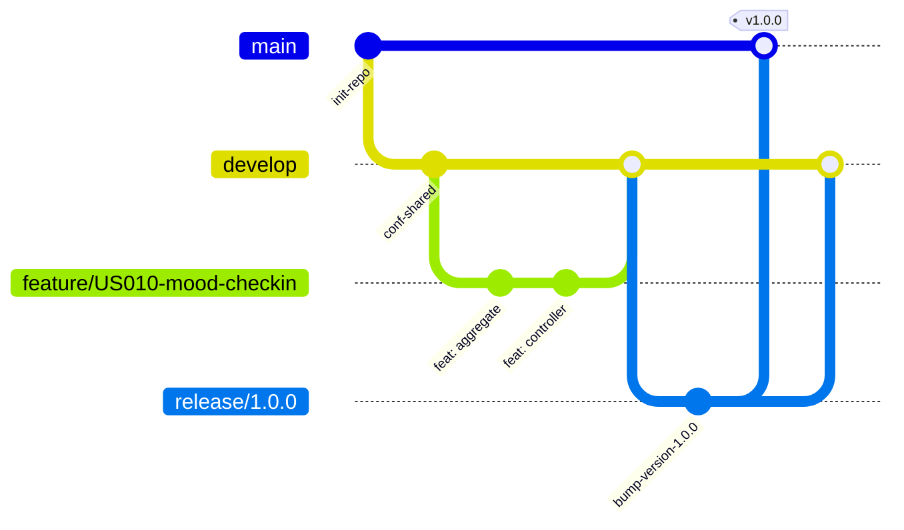

- **`main`**: Rama protegida que contiene únicamente código estable, auditado y listo para producción. Cada merge en `main` se asocia a un tag de versión oficial.
- **`develop`**: Rama base para el desarrollo diario e integración continua. Todas las nuevas funcionalidades convergen aquí mediante Pull Requests validados por el equipo.
- **`feature/<id-historia>-<nombre-descriptivo>`**: Ramas temporales creadas a partir de `develop` para implementar una historia de usuario o historia técnica específica (ej. `feature/US010-mood-checkin`, `feature/US001-account-registration`).
- **`release/<major.minor.patch>`**: Ramas de estabilización previas a una entrega oficial para ajustar detalles de configuración, documentación y pruebas finales.
- **`hotfix/<descripcion-parche>`**: Ramas de corrección urgente derivadas directamente de `main` para resolver bugs críticos detectados en producción.

#### Versionado Semántico (Semantic Versioning 2.0.0)

Se adopta el estándar `MAJOR.MINOR.PATCH` para etiquetar los lanzamientos del producto:
- **MAJOR (`X.0.0`):** Cambios que rompen la compatibilidad hacia atrás en APIs o contratos de datos.
- **MINOR (`0.X.0`):** Nuevas funcionalidades completas asociadas al cierre de un Sprint o la inclusión de un Bounded Context.
- **PATCH (`0.0.X`):** Correcciones menores de errores, refactorizaciones internas o ajustes de documentación.

#### Estándar de Mensajes de Commit (Conventional Commits 1.0.0)

Los commits deben redactarse obligatoriamente siguiendo la convención:
```text
<tipo>(<alcance opcional>): <descripción concisa en imperativo y minúsculas>

[cuerpo explicativo opcional sobre el motivo de la modificación]

[referencia a historia de usuario: Closes US-010]
```

Tipos admitidos:
- **`feat`**: Incorporación de una nueva funcionalidad técnica o de usuario.
- **`fix`**: Corrección de un defecto o fallo detectado.
- **`docs`**: Modificaciones exclusivas a la documentación o archivos Markdown.
- **`style`**: Ajustes de formato, espaciado o indentación sin alteración en la lógica.
- **`refactor`**: Reestructuración interna de código que no añade funcionalidades ni repara errores.
- **`test`**: Incorporación o ajuste de pruebas unitarias o de integración.
- **`chore`**: Tareas de mantenimiento, actualización de dependencias (`pom.xml`) o ajustes en el build.

---

### 4.1.3. Source Code Style Guide & Conventions

Para garantizar que el código fuente sea homogéneo, legible y fácil de mantener entre todos los integrantes, se establecieron lineamientos formales basados en las guías más reconocidas de la industria:

#### Referencias Oficiales de Estilo
- **Java:** [Google Java Style Guide](https://google.github.io/styleguide/javaguide.html) y [Spring Framework Architecture Best Practices](https://docs.spring.io/spring-boot/docs/current/reference/htmlsingle/).
- **Dart / Flutter:** [Effective Dart: Style Guide](https://dart.dev/guides/language/effective-dart/style) y lineamientos de [Material Design 3 (M3)](https://m3.material.io/).
- **Web / Frontend:** [Google HTML/CSS Style Guide](https://google.github.io/styleguide/htmlcssguide.html) y [Airbnb JavaScript Style Guide](https://github.com/airbnb/javascript).

#### Estructura de Código DDD (Domain-Driven Design) en Backend
En `safediary-platform`, el código fuente se divide modularmente por Bounded Contexts (`iam`, `profiles`, `diary`, `rutines`, etc.) con una separación estricta en 4 capas hexagonales:
- **`domain`**: Entidades, agregados, Value Objects y contratos de repositorios sin dependencias de infraestructura ni frameworks.
- **`application`**: Casos de uso divididos bajo el patrón CQRS (`internal/commandservices`, `internal/queryservices`).
- **`infrastructure`**: Adaptadores técnicos de persistencia JPA, configuración de OpenAPI/Swagger, hashing de contraseñas y manejadores de eventos.
- **`interfaces.rest`**: Controladores REST (`@RestController`), recursos/DTOs de transferencia y clases `Assembler` para transformación de modelos.

#### Convenciones de Nomenclatura

| Elemento Técnico | Convención | Ejemplo en SafeDiary |
| :--- | :--- | :--- |
| **Clases Java** | PascalCase | `MoodCheckIn`, `DiaryEntriesController` |
| **Métodos y Atributos Java** | camelCase | `calculateStreakDays()`, `patientId` |
| **Constantes Java** | UPPER_SNAKE_CASE | `MAX_CHECKIN_COMMENT_LENGTH` |
| **Paquetes Java** | minúsculas continuas | `com.mindcluster.safediary.diary` |
| **Clases y Widgets Dart** | PascalCase | `MoodCheckInScreen`, `EmotionCard` |
| **Archivos y Directorios Dart** | snake_case | `mood_check_in_screen.dart` |
| **Tablas PostgreSQL** | snake_case pluralizado | `mood_check_ins`, `diary_entries`, `user_accounts` |
| **Columnas PostgreSQL** | snake_case | `created_at`, `sentiment_score` |
| **Endpoints RESTful** | kebab-case pluralizado | `/api/v1/mood-check-ins`, `/api/v1/diary-entries` |

#### Lineamientos por Lenguaje
- **Java (Spring Boot):**
  - Inyección de dependencias exclusivamente por constructor (evitando `@Autowired` en atributos).
  - Reducción de código repetitivo mediante Lombok (`@Getter`, `@Setter`, `@Builder`, `@NoArgsConstructor`).
  - Validación declarativa de datos de entrada en DTOs con Bean Validation (`@NotNull`, `@NotBlank`, `@Size`).
  - Documentación de clases públicas y controladores mediante anotaciones Swagger (`@Tag`, `@Operation`).
- **Dart (Flutter):**
  - Tipado estricto en todas las variables, evitando el uso indiscriminado de `dynamic`.
  - Construcción de widgets modulares y reutilizables con longitud máxima recomendada de 100 líneas por build method.
  - Implementación de componentes nativos de Material 3 (`ColorScheme`, `Card`, `FilledButton`, `NavigationRail`).
- **HTML / CSS (Landing Page):**
  - Maquetación 100% semántica utilizando etiquetas HTML5 (`<header>`, `<nav>`, `<main>`, `<section>`, `<footer>`).
  - Enfoque *Mobile-First* en CSS con diseño responsive garantizado para pantallas móviles, tablets y monitores desktop.

---

### 4.1.4. Software Deployment Configuration

El proceso de despliegue asegura que cada pieza del sistema esté disponible en entornos cloud con alta disponibilidad, seguridad TLS/SSL y monitoreo constante:

#### 1. Despliegue de la Landing Page (`safediary-landing-page`)
- **Plataforma de Hosting:** GitHub Pages.
- **Pipeline de Despliegue:** Integración continua automática (CI/CD) vinculada al branch `main`. Cada pull request aprobado e integrado desencadena un nuevo build y publicación.
- **URL Pública:** [https://mindclusterupc.github.io/SafeDiary_Landing_Page/](https://mindclusterupc.github.io/SafeDiary_Landing_Page/index.html)
- **Características:** Certificados SSL/TLS gestionados automáticamente, compresión gzip/brotli y distribución a través de CDN global.

#### 2. Despliegue del Backend RESTful API (`safediary-platform`)
- **Plataforma Cloud:** Render (servicio web Docker definido en `render.yaml`, despliegue automático desde `main`).
- **Base de Datos:** PostgreSQL externo en Neon con pool de conexiones HikariCP; perfil `prod` de Spring.
- **Estrategia de Ejecución:**
  - Imagen Docker construida con el `Dockerfile` del repositorio (build Maven `package -DskipTests` y ejecución del `.jar`).
  - El servicio lee el puerto de la variable `PORT` y verifica su salud con `/v3/api-docs`.
  - Gestión segura de credenciales sensibles (cadenas de conexión JDBC, usuario y contraseña de base de datos) a través de variables de entorno seguras en el panel cloud.
- **Documentación Interactiva Pública:** [Swagger UI](https://safediary-platform.onrender.com/swagger-ui/index.html) para pruebas de endpoints por parte del equipo móvil y evaluadores.

#### 3. Despliegue de la Aplicación para Pacientes (`SafeDiary-Android`)
- **Tecnología:** aplicación nativa Android en Kotlin con Jetpack Compose (minSdk 24, targetSdk 37).
- **Empaquetado Release:** APK firmado generado con Gradle (`./gradlew assembleRelease`); la firma se lee de un archivo local fuera del repositorio.
- **Canal de Distribución:** instalación del APK en dispositivos y emuladores Android del equipo para las pruebas del sprint.
- **Integración con Backend:** la URL base se define por tipo de build en `BuildConfig.API_BASE_URL`: el build debug apunta al backend local y el release al backend desplegado en Render por HTTPS.

#### 4. Despliegue de la Aplicación para Psicólogos (`SafeDiary_Flutter`)

- **Repositorio:** [MindClusterUPC/SafeDiary_Flutter](https://github.com/MindClusterUPC/SafeDiary_Flutter), rama `develop`.
- **Tecnología y versión:** Flutter y Dart; paquete `safediary_clinical`, versión `1.0.0+1` declarada en `pubspec.yaml` e identificador Android `com.mindcluster.safediary_clinical`. Se instala junto a la app del paciente.
- **Canal del sprint:** APK para pruebas locales en Android. La compilación debug utiliza `flutter build apk --debug --target-platform android-x64`; la compilación release utiliza `flutter build apk --release --dart-define=API_BASE_URL=https://TU_BACKEND` con la URL HTTPS del entorno correspondiente.
- **Integración con Backend:** `API_BASE_URL` se configura mediante `--dart-define`. El valor predeterminado `http://10.0.2.2:8080` conecta el emulador con el backend local. La app usa autenticación Bearer y cuentas con rol `PSYCHOLOGIST`.
- **Distribución:** el canal de pruebas no equivale a una publicación en tienda ni en Firebase App Distribution. La configuración versionada de release usa la clave debug; antes de una distribución de producción debe configurarse la firma propia.
- **Proveedores externos:** la videollamada se abre en el navegador tras obtener autorización del backend. La configuración de cobros abre Stripe Connect y requiere las credenciales de ese proveedor en el servidor.

## 4.2. Landing Page & Mobile Application Implementation

### 4.2.1. Sprint 1

#### 4.2.1.1. Sprint Planning 1

| Campo | Valor |
|---|---|
| Sprint | Sprint 1 |
| Fecha | 2026-09-26 |
| Hora | 17:00 |
| Ubicación | Virtual - Discord |
| Preparado por | Kamil Diaz |
| Asistentes | Marcelo Cuadros, Andres Torres, Juan Wang, Santiago Vargas |
| Sprint Goal | **Nuestro foco está en** completar el primer recorrido del paciente conectado al backend: cuenta propia con IAM, diario personal con auto-guardado offline-first, conversación con Diarito, directorio de psicólogos, coordinación y reserva de citas, y rutinas de autocuidado. <br><br> **Creemos que esto habilitará** que un paciente pueda registrar lo que siente, buscar apoyo profesional y agendar una sesión desde la misma aplicación, con sus datos visibles solo para su cuenta. <br><br> **Esto se confirmará cuando** las suites de pruebas del backend y de la app pasen sin fallos, cada endpoint privado rechace el acceso de otra cuenta y el recorrido completo funcione en un dispositivo Android contra el backend desplegado. |
| Velocity | 35 |
| Story Points incluidos | 32 |

#### 4.2.1.2. Aspect Leaders and Collaborators

| Team Member (Last Name, First Name) | GitHub Username | IAM Leader (L) / Collaborator (C) | Profile Leader (L) / Collaborator (C) | Diary Leader (L) / Collaborator (C) | AssistantAI Leader (L) / Collaborator (C) | Clinician Directory Leader (L) / Collaborator (C) | Care Scheduling Leader (L) / Collaborator (C) | Payment and Payouts Leader (L) / Collaborator (C) | Rutines Leader (L) / Collaborator (C) |
|---|---|:---:|:---:|:---:|:---:|:---:|:---:|:---:|:---:|
| Cuadros Villanueva, Marcelo Fabio | Marcelo-alt-lab | C | L | C | C | C | C | L | C |
| Diaz Martinez, Alexther Kamil | kamil-tron | C | C | C | C | L | C | C | C |
| Torres Lavandera, Andres Rodrigo | AndresTorres202312557 | L | C | C | C | C | L | C | C |
| Vargas Alarcon, Santiago Enrique | SanVargasAl | C | C | C | C | C | C | C | L |
| Wang Chen, Juan Sung Jau | jwd3t | C | C | L | L | C | C | C | C |

#### 4.2.1.3. Sprint Backlog 1

El Sprint Backlog 1 se gestiona en Trello. Contiene las 12 historias de prioridad alta seleccionadas del Product Backlog, que suman **32 Story Points**. Cada tarjeta incluye la historia de usuario, sus criterios de aceptación, los Story Points y una etiqueta por épica. El tablero tiene las listas `Sprint 1 Backlog`, `To Do`, `In Process`, `To Review` y `Done`, y las tarjetas avanzan entre ellas según su estado. Al cierre del sprint, las cuatro historias de la Landing Page están en `Done`, la edición del perfil (US-006) en `To Review`, la reflexión con IA (US-011) en `In Process` y las historias de IAM y Diary en `To Do`.

| User Story ID | Título | Épica | Story Points | Criterios de aceptación | Estado |
|---|---|---|---:|---|---|
| US-001 | Registro de cuenta | EP-01 Cuenta, Seguridad y Privacidad | 3 | Registro exitoso con inicio de sesión y bienvenida; validación de correo duplicado o contraseña débil sin borrar los campos válidos. | To Do |
| US-003 | Acceso con Google o Apple | EP-01 Cuenta, Seguridad y Privacidad | 3 | Autenticación federada que crea o recupera la cuenta; manejo seguro de la cancelación o falla del proveedor. | To Do |
| US-006 | Edición del perfil personal | EP-01 Cuenta, Seguridad y Privacidad | 2 | Perfil y foto actualizados; validación de tamaño o formato de imagen no admitido. | To Review |
| US-015 | Desbloqueo biométrico | EP-01 Cuenta, Seguridad y Privacidad | 3 | Biometría habilitada; contraseña tradicional si la biometría falla. | To Do |
| US-016 | Recuperación de contraseña | EP-01 Cuenta, Seguridad y Privacidad | 3 | Enlace temporal enviado al correo; enlaces caducados manejados sin revelar si la cuenta existe. | To Do |
| US-008 | Registro de entrada de diario | EP-02 Diario Emocional e IA | 3 | Almacenamiento cifrado en orden cronológico; bloqueo de entradas vacías. | To Do |
| US-010 | Registro rápido del estado emocional | EP-02 Diario Emocional e IA | 3 | Emoción guardada con timestamp; prevención de registros duplicados inmediatos. | To Do |
| US-011 | Reflexión guiada por voz con IA | EP-02 Diario Emocional e IA | 8 | Transcripción, reflexión no clínica y etiqueta emocional; parada segura ante límites de tiempo o fallas de red sin perder el audio. | In Process |
| US-017 | Presentación de la propuesta de valor | EP-05 Landing Page y Adquisición | 1 | Hero section con mensaje central y botón de descarga o prueba en el primer pliegue. | Done |
| US-018 | Presentación de funcionalidades principales | EP-05 Landing Page y Adquisición | 1 | Tarjetas de funciones con icono y descripción; scroll suave desde el menú. | Done |
| US-019 | Consulta de testimonios | EP-05 Landing Page y Adquisición | 1 | Reseñas anonimizadas con calificación; estado alternativo si no hay testimonios aprobados. | Done |
| US-020 | Consulta de planes y precios | EP-05 Landing Page y Adquisición | 1 | Tres tarjetas comparables (Básico Gratis, Terra US$ 19.99/mes y Astrum US$ 100/año); enlaces a registro o contratación. | Done |

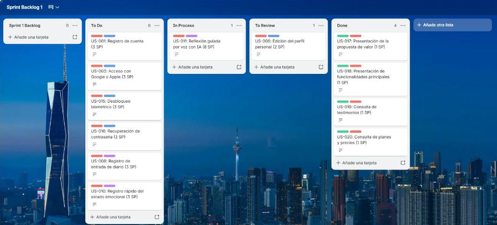

**URL del tablero:** [Sprint Backlog 1 en Trello](https://trello.com/b/UgUM8rrn/sprint-backlog-1).

#### 4.2.1.4. Development Evidence for Sprint Review

Durante el Sprint 1 se implementaron incrementos en los tres repositorios de código. Los cambios se integran en `develop` mediante ramas `feature/*` (GitFlow) y los mensajes siguen Conventional Commits. La tabla resume los commits más representativos.

| Repositorio | Rama | Commit | Mensaje | Fecha | Relación con User Story |
|---|---|---|---|---|---|
| SafeDiary_Landing_Page | feature | [`7a1779f`](https://github.com/MindClusterUPC/SafeDiary_Landing_Page/commit/7a1779f) | feat(pages): add accessible landing page and terms & conditions views | 2026-10-04 | US-017, US-018 |
| SafeDiary_Landing_Page | feature | [`fdd6311`](https://github.com/MindClusterUPC/SafeDiary_Landing_Page/commit/fdd6311) | feat(i18n-js): add reactive i18n engine and interactive UI modules | 2026-10-04 | US-017, US-018 |
| SafeDiary_Landing_Page | feature/pricing | [`3eeb6f7`](https://github.com/MindClusterUPC/SafeDiary_Landing_Page/commit/3eeb6f7) | feat: add pricing plans section | 2026-10-07 | US-020 |
| SafeDiary_Landing_Page | main | [`a5cdb7e`](https://github.com/MindClusterUPC/SafeDiary_Landing_Page/commit/a5cdb7e) | feat: refresh landing and interactive screen carousel | 2026-10-08 | US-018, US-019 |
| safediary-platform | feature | [`24b01e5`](https://github.com/MindClusterUPC/safediary-platform/commit/24b01e5) | feat(assistantai): support regenerating the last assistant reply | 2026-10-04 | US-011 |
| safediary-platform | feature | [`1c89084`](https://github.com/MindClusterUPC/safediary-platform/commit/1c89084) | build: add dockerfile and render blueprint for deployment | 2026-10-04 | Despliegue |
| safediary-platform | feature/Profile | [`0e63f5f`](https://github.com/MindClusterUPC/safediary-platform/commit/0e63f5f) | Merge branch 'feature/Profile' into develop | 2026-10-08 | US-006 |
| safediary-platform | feature/clinician-directory | [`df1a0d8`](https://github.com/MindClusterUPC/safediary-platform/commit/df1a0d8) | feat(cliniciandirectory): expose rest endpoints and development iam integration | 2026-10-09 | Directorio de psicólogos |
| safediary-platform | feature/rutines | [`b8789ae`](https://github.com/MindClusterUPC/safediary-platform/commit/b8789ae) | Rutines interface layer implementation | 2026-10-09 | Rutinas |
| safediary-platform | feature/payments | [`31337c1`](https://github.com/MindClusterUPC/safediary-platform/commit/31337c1) | feat(payments): expose REST controllers, ACL facade, and add automated tests | 2026-10-09 | US-020 (planes) |
| safediary-platform | feature/care-scheduling | [`0f6fe75`](https://github.com/MindClusterUPC/safediary-platform/commit/0f6fe75) | feat(care-scheduling): expose REST controllers and development payment simulation | 2026-10-09 | Citas |
| SafeDiary-Android | feature | [`8ea54d4`](https://github.com/MindClusterUPC/SafeDiary-Android/commit/8ea54d4) | feat(assistantai): persist personality and include in prompt request | 2026-10-04 | US-011 |
| SafeDiary-Android | feature | [`5d03796`](https://github.com/MindClusterUPC/SafeDiary-Android/commit/5d03796) | feat(assistantai): show crisis support card with local hotlines in the chat | 2026-10-04 | US-011 |
| SafeDiary-Android | feature | [`800ef71`](https://github.com/MindClusterUPC/SafeDiary-Android/commit/800ef71) | feat: match chat, drawer and navigation to the design | 2026-10-06 | US-011 |
| SafeDiary-Android | feature | [`13f92e6`](https://github.com/MindClusterUPC/SafeDiary-Android/commit/13f92e6) | feat: add offline cache and swipe navigation | 2026-10-06 | US-011 |

**Incrementos logrados:**

- **Landing Page:** hero, funcionalidades, carrusel de pantallas de la app, testimonios, planes (Básico, Terra y Astrum), preguntas frecuentes, equipo y Términos y Condiciones, en español e inglés.
- **Backend:** AssistantAI (chat con Diarito, historial, edición y regeneración de mensajes, evaluación de riesgo y recursos de crisis), Profiles, Rutines, Clinician Directory, Care Scheduling y Payments, desplegados en Render con la versión v0.2.0.
- **Aplicación móvil:** chat con Diarito conectado al backend, personalidades, historial lateral, tarjeta de crisis con la Línea 113, caché offline y navegación por deslizamiento.

#### 4.2.1.5. Testing Suite Evidence for Sprint Review

La suite de pruebas del Sprint 1 combina tres niveles. Las pruebas unitarias usan **JUnit 5** y **Mockito** (repositorios y servicios externos simulados), las de integración levantan el contexto de Spring Boot con **MockMvc** sobre una base H2 en memoria, y las de aceptación se escriben en Gherkin con **Karate**, que llama a la API real en un puerto aleatorio. **JaCoCo** mide la cobertura y un **Jenkinsfile** ejecuta todo en integración continua.

**Resultado de la ejecución (`./mvnw clean verify`, rama `develop`):** 121 pruebas en el backend, 0 fallos, 0 errores; cobertura de líneas de 58,9 %. En la aplicación móvil (`./gradlew testDebugUnitTest`): 19 pruebas, 0 fallos.

| Tipo de prueba | User Story / contexto | Caso / clase | Resultado | Ruta |
|---|---|---|---|---|
| Unit (Mockito) | US-006 · Profiles | `ProfileCommandServiceImplTest` (7), `ProfileQueryServiceImplTest` (6) | 13 passed | [profiles](https://github.com/MindClusterUPC/safediary-platform/tree/develop/src/test/java/com/mindcluster/safediary/profiles) |
| Unit (Mockito) | Rutines | `RoutineCommandServiceImplTest` (7), `RoutineQueryServiceImplTest` (6) | 13 passed | [rutines](https://github.com/MindClusterUPC/safediary-platform/tree/develop/src/test/java/com/mindcluster/safediary/rutines) |
| Unit (Mockito) | US-011 · AssistantAI | `ConversationCommandServiceImplTest` (6), `ConversationQueryServiceImplTest` (5) | 11 passed | [assistantai](https://github.com/MindClusterUPC/safediary-platform/tree/develop/src/test/java/com/mindcluster/safediary/assistantai/application) |
| Unit (dominio) | US-011 · AssistantAI | `ConversationSessionTest`, `RiskPolicyServiceTest`, `RiskAssessmentTest`, `EmotionClassifierServiceTest`, `CognitiveDistortionServiceTest`, `ClinicalSummaryTest`, `ClinicalSummarySynthesizerServiceTest`, assembler | 37 passed | [assistantai/domain](https://github.com/MindClusterUPC/safediary-platform/tree/develop/src/test/java/com/mindcluster/safediary/assistantai/domain) |
| Unit (dominio) | Care Scheduling · Payments | `AppointmentTest`, `BookableSlotCalculatorTest`, `SubscriptionTest`, `SubscriptionCommandServiceTest` | 20 passed | [carescheduling](https://github.com/MindClusterUPC/safediary-platform/tree/develop/src/test/java/com/mindcluster/safediary/carescheduling), [payments](https://github.com/MindClusterUPC/safediary-platform/tree/develop/src/test/java/com/mindcluster/safediary/payments) |
| Integration | Clinician Directory | `DirectoryApiIntegrationTest`, `DevelopmentIamRoleClientTest` | 15 passed | [cliniciandirectory](https://github.com/MindClusterUPC/safediary-platform/tree/develop/src/test/java/com/mindcluster/safediary/cliniciandirectory) |
| Integration | Care Scheduling | `CareSchedulingApiIntegrationTest` | 4 passed | [carescheduling](https://github.com/MindClusterUPC/safediary-platform/tree/develop/src/test/java/com/mindcluster/safediary/carescheduling) |
| Acceptance / BDD (Karate) | US-006 · Profiles | `patients.feature`: registrar paciente, consultar por id y actualizar contacto de emergencia; id inexistente | 2 passed | [patients.feature](https://github.com/MindClusterUPC/safediary-platform/tree/develop/src/test/resources/karate/profiles/patients.feature) |
| Acceptance / BDD (Karate) | Rutines | `daily-routines.feature`: crear, listar por paciente y activar o desactivar; payload inválido | 2 passed | [daily-routines.feature](https://github.com/MindClusterUPC/safediary-platform/tree/develop/src/test/resources/karate/rutines/daily-routines.feature) |
| Acceptance / BDD (Karate) | US-011 · seguridad | `crisis-resources.feature`: líneas de ayuda con la Línea 113 | 1 passed | [crisis-resources.feature](https://github.com/MindClusterUPC/safediary-platform/tree/develop/src/test/resources/karate/assistantai/crisis-resources.feature) |
| Acceptance / BDD (Karate) | Clinician Directory | `clinicians.feature`: búsqueda y psicólogo inexistente | 2 passed | [clinicians.feature](https://github.com/MindClusterUPC/safediary-platform/tree/develop/src/test/resources/karate/cliniciandirectory/clinicians.feature) |
| Unit (móvil) | US-011 · Diarito | `AiConversationAggregateTest` (10), `DiaritoPersonalityTest` (5), `OfflineChatTest` (3) | 18 passed | [app/src/test](https://github.com/MindClusterUPC/SafeDiary-Android/tree/develop/app/src/test) |

**Pipeline de integración continua:** el `Jenkinsfile` del backend define las etapas *Compile*, *Unit Tests* (excluye los runners de Karate), *Acceptance Tests* (Karate), *Coverage* (reporte y umbral de JaCoCo) y *Package*. Publica los reportes de Surefire, el sitio de JaCoCo y el reporte HTML de Karate.

**Criterios de prueba y datos utilizados:** se usan datos ficticios (nombres, correos `@example.com` y teléfonos de prueba) en una base H2 en memoria que se crea en cada ejecución; el proveedor de IA se reemplaza por un doble de prueba, por lo que ninguna prueba llama a servicios externos ni usa datos personales reales. Las historias US-001, US-003, US-015 y US-016 (IAM) y US-008 y US-010 (Diary) aún no tienen endpoints en el backend; sus escenarios de aceptación son los criterios en Gherkin del capítulo 2 y se automatizarán cuando esos contextos se implementen.

#### 4.2.1.6. Execution Evidence for Sprint Review

En el Sprint 1 la aplicación móvil alcanzó el flujo principal del asistente Diarito conectado al backend desplegado en Render. El usuario puede iniciar una conversación desde sugerencias o texto libre, recibir una reflexión no clínica, copiar, editar o regenerar mensajes, consultar y renombrar su historial, elegir la personalidad de Diarito y acceder a la Línea 113 desde la configuración. Las conversaciones se guardan en caché local (Room) para consultarlas sin conexión. Las pestañas Rutines, Home, Psychologist y Scheduling ya forman parte de la navegación inferior, pero sus pantallas se implementarán en los siguientes sprints junto con IAM y Diary.

| Funcionalidad demostrada | Dispositivo / entorno | Resultado | Evidencia |
|---|---|---|---|
| Inicio de Diarito con sugerencias y navegación inferior | Emulador Pixel 10 Pro, Android 17 · APK release 1.0 | Correcto | Captura 1 |
| Conversación con Diarito: respuesta del backend en Render con acciones de copiar, editar y regenerar | Emulador Pixel 10 Pro, Android 17 · APK release 1.0 | Correcto | Captura 2 |
| Historial de conversaciones sincronizado con el backend, con búsqueda y opciones de renombrar y eliminar | Emulador Pixel 10 Pro, Android 17 · APK release 1.0 | Correcto | Captura 3 |
| Configuración: personalidades Sol, Luma, Kai y Nara, idioma y botón de la Línea 113 | Emulador Pixel 10 Pro, Android 17 · APK release 1.0 | Correcto | Captura 4 |

<table>
<tr>
<td align="center">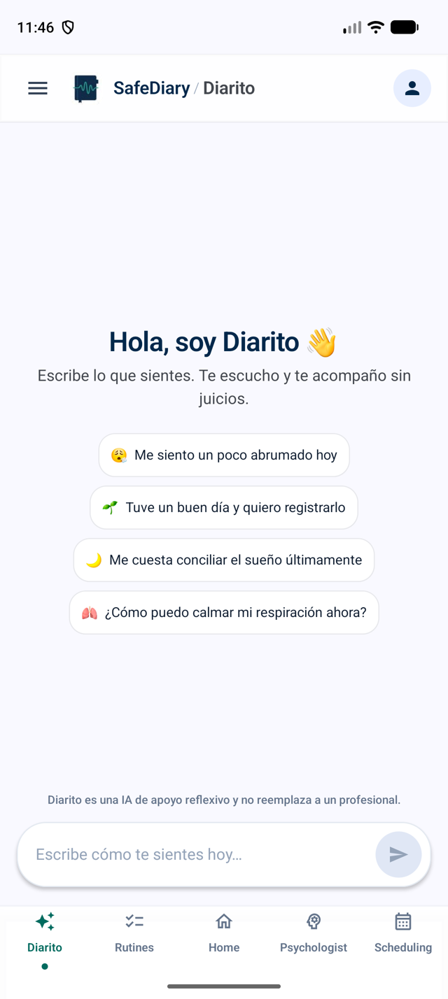<br>Captura 1. Inicio de Diarito</td>
<td align="center">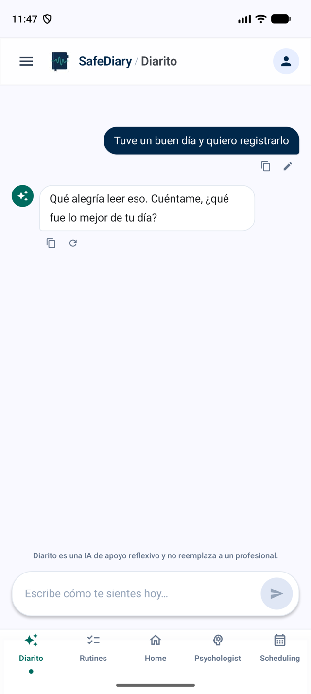<br>Captura 2. Respuesta de Diarito</td>
<td align="center">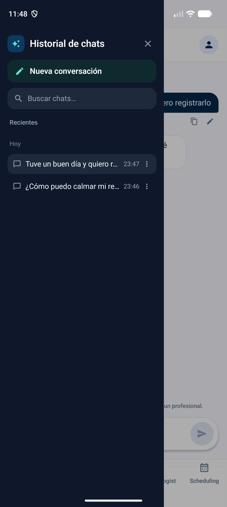<br>Captura 3. Historial</td>
<td align="center">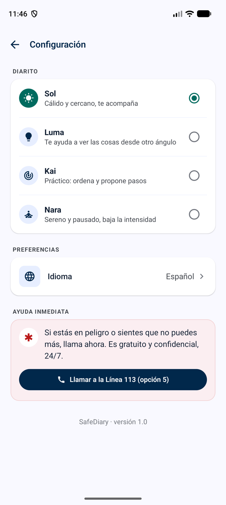<br>Captura 4. Configuración</td>
</tr>
</table>

#### 4.2.1.7. Services Documentation Evidence for Sprint Review

Los servicios del backend se documentan con OpenAPI (springdoc). La documentación interactiva está publicada en [Swagger UI](https://safediary-platform.onrender.com/swagger-ui/index.html) y cada bounded context describe sus endpoints en la carpeta `docs/` del repositorio [safediary-platform](https://github.com/MindClusterUPC/safediary-platform).

| Servicio | Método | Ruta | Parámetros | Response esperado | Estado |
|---|---|---|---|---|---|
| Assistant Chat | POST | `/api/v1/assistant/chat` | body: mensaje, `conversationId` opcional, idioma y personalidad | 200: respuesta de Diarito, nivel de riesgo y recursos de crisis | Desplegado |
| Assistant Chat | GET | `/api/v1/assistant/conversations` | — | 200: conversaciones de la cuenta, más recientes primero | Desplegado |
| Assistant Chat | GET / PATCH / DELETE | `/api/v1/assistant/conversations/{conversationId}` | path: `conversationId`; body PATCH: título | 200: conversación con mensajes / renombrada / eliminada | Desplegado |
| Assistant Chat | PUT | `/api/v1/assistant/conversations/{conversationId}/messages/{messageId}` | body: nuevo contenido | 200: mensaje editado y diálogo regenerado | Desplegado |
| Assistant Chat | POST | `/api/v1/assistant/conversations/{conversationId}/regenerate` | path: `conversationId` | 200: nueva respuesta de Diarito | Desplegado |
| Conversation Sessions | POST / GET | `/api/v1/conversation-sessions`, `/active`, `/{sessionId}` | cuenta y `sessionId` | 200: sesión de conversación | Desplegado |
| Crisis Alerts | GET | `/api/v1/crisis-resources` | — | 200: líneas de ayuda (Línea 113, SAMU 106) | Desplegado |
| Clinical Summaries | POST / GET | `/api/v1/clinical-summaries` | cuenta y semana | 200: resumen emocional semanal | Desplegado |
| Profiles | POST / GET | `/api/v1/patients`, `/api/v1/patients/{id}` | body: datos del paciente | 201 / 200: perfil del paciente | Desplegado |
| Profiles | PUT | `/api/v1/patients/{id}/emergency-contact` | body: contacto de apoyo | 200: contacto actualizado | Desplegado |
| Rutines | POST / GET / PUT / PATCH | `/api/v1/daily-routines`, `/patient/{patientId}`, `/{id}/toggle-active` | body: rutina y recordatorio | 201 / 200: rutina | Desplegado |
| Clinician Directory | GET | `/api/v1/clinicians/{id}`, `/{id}/reviews`, `/{id}/rating` | path: `id` | 200: ficha, reseñas y calificación | Desplegado |
| Care Scheduling | GET / POST | `/api/v1/schedule/clinicians/{clinicianId}/slots`, `/proposals`, `/proposals/{appointmentId}/acceptance` | horario propuesto | 200: horarios libres / reserva temporal | Desplegado |
| Payments | POST / GET | `/api/v1/payments/subscriptions/checkout`, `/current`, `/cancel` | body: plan (Terra o Astrum) | 200: sesión de pago y suscripción vigente | Desplegado |

**Interacción con la documentación desplegada (datos de muestra):**

Las siguientes capturas muestran la ejecución de endpoints desde Swagger UI sobre el backend en Render (v0.2.1), usando datos ficticios.

1. **`GET /api/v1/crisis-resources`:** sin parámetros. Responde `200` con las líneas de ayuda que la app muestra ante un riesgo alto: Línea 113 (opción 5) y SAMU 106.

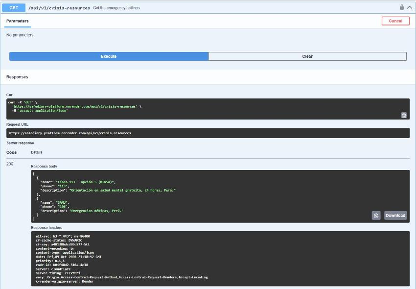

2. **`POST /api/v1/daily-routines`:** el body indica el paciente, el título de la rutina, los días de la semana y si se activan los recordatorios. Responde `201` con la rutina creada, su id y el estado de notificación `ENABLED`.

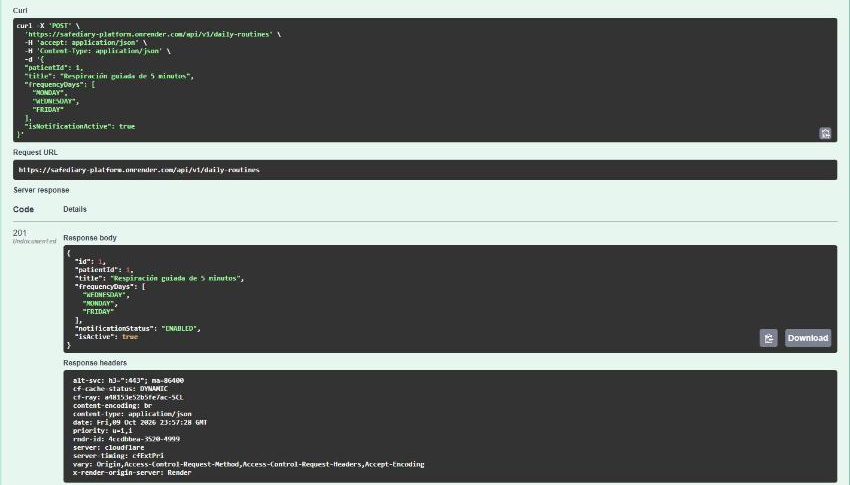

3. **`GET /api/v1/patients/{id}`:** con el parámetro de ruta `id = 1`. Responde `200` con el perfil del paciente y su contacto de apoyo.

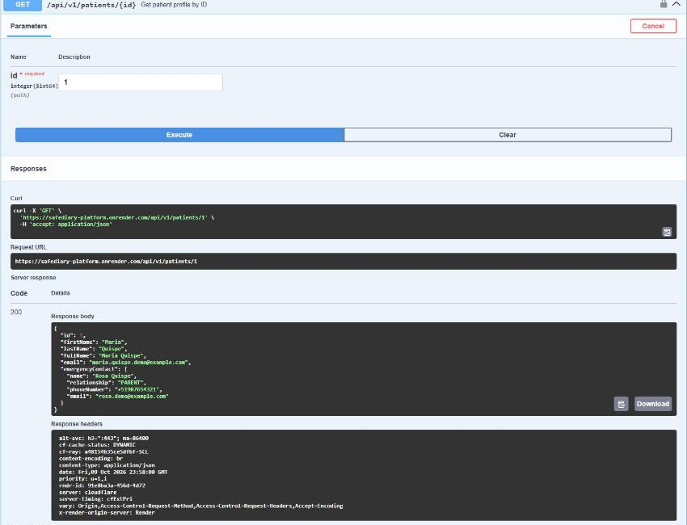

#### 4.2.1.8. Software Deployment Evidence for Sprint Review

La configuración de cada despliegue se describe en la sección 4.1.4. La Landing Page se publica en GitHub Pages desde `main`; el backend se despliega en Render como servicio Docker desde `main`. La versión v0.1.0 (5 de octubre) publicó AssistantAI y la versión v0.2.0 (9 de octubre) integró Profiles, Rutines, Clinician Directory, Care Scheduling y Payments, de modo que los endpoints del sprint están disponibles en Swagger. La versión v0.2.1 corrigió la creación de los schemas de cada contexto en PostgreSQL; la aplicación móvil se prueba como APK en emuladores y dispositivos Android apuntando al backend de Render.

| Producto | Plataforma | URL / versión | Fecha | Evidencia |
|---|---|---|---|---|
| Landing Page | GitHub Pages | [https://mindclusterupc.github.io/SafeDiary_Landing_Page/](https://mindclusterupc.github.io/SafeDiary_Landing_Page/index.html) | 2026-10-08 | 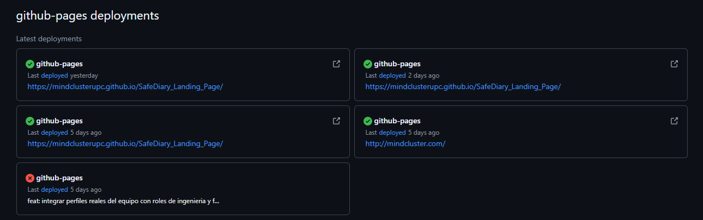 |
| Backend | Render (Docker) | [Swagger UI](https://safediary-platform.onrender.com/swagger-ui/index.html) · v0.2.0 | 2026-10-09 | 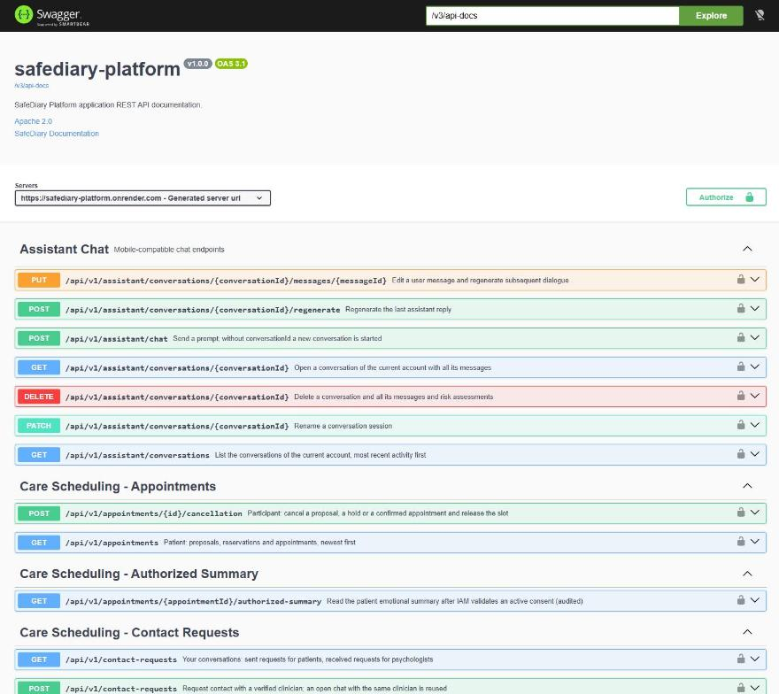 |
| Mobile | Emulador y dispositivo Android | APK release 1.0 | 2026-10-06 | Build firmado apuntando a Render |

**Despliegue del backend en Render:** el servicio `safediary-platform` (Docker, rama `main`) está en estado *Live* con el commit `da151c7`, correspondiente al merge de la versión v0.2.0.

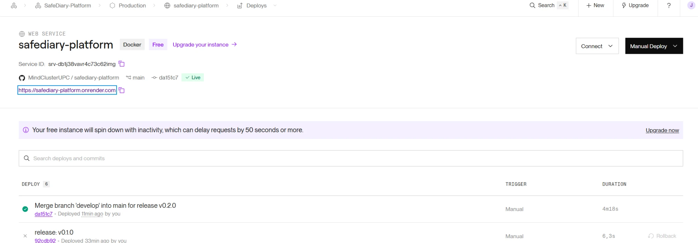

#### 4.2.1.9. Team Collaboration Insights during Sprint

Durante el desarrollo del Sprint 1, el equipo implementó una dinámica de trabajo colaborativa, transparente y continua a través de los repositorios que conforman la solución en la organización de GitHub. La asignación y avance de actividades se gestionó de forma sincronizada mediante el tablero del sprint, manteniendo una correspondencia directa entre los ítems priorizados y los incrementos de software desarrollados para la Landing Page, la aplicación móvil y la plataforma de servicios backend.

Para asegurar la calidad y estabilidad de la base de código, se adoptó el flujo de trabajo GitFlow, organizando el desarrollo en ramas por funcionalidad (*feature branches*). Cada componente o bounded context fue abordado de forma modular, permitiendo el avance simultáneo de los diferentes módulos del sistema sin generar bloqueos mutuos. La integración hacia las ramas compartidas se realizó mediante *Pull Requests* y revisiones entre pares (*code reviews*), verificando la consistencia arquitectural, el cumplimiento de pruebas automatizadas y el seguimiento de estándares de codificación y *Conventional Commits*.

##### Resumen de Actividad y Flujo de Integración (Pulse)

El seguimiento de actividad refleja un ciclo de desarrollo activo y coordinado a lo largo del periodo del sprint. La gestión de ramas y solicitudes de extracción permitió incorporar los cambios validados de manera progresiva, asegurando que las entregas funcionales y configuraciones de despliegue se consolidaran de forma continua y ordenada.

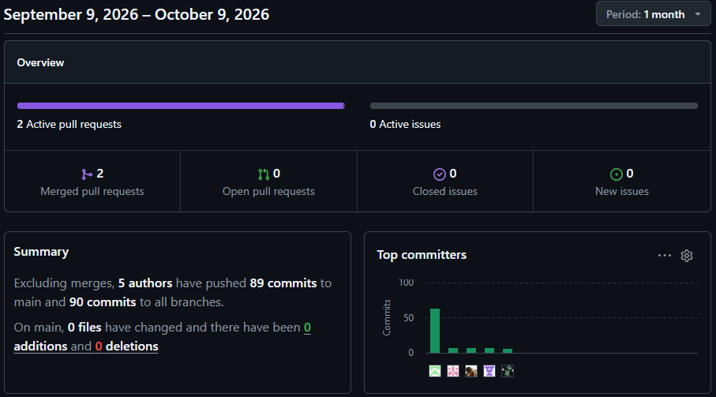

##### Distribución de Contribuciones en el Repositorio (Contributions)

Las métricas de contribución evidencian una participación distribuida y complementaria a lo largo del sprint, con aportes continuos enfocados en la implementación de nuevas funcionalidades, la refactorización arquitectural y la estabilización de los componentes previo al cierre del ciclo. Las curvas de adición y ajuste de código reflejan el esfuerzo conjunto en la construcción de los servicios de backend, las interfaces de usuario y la documentación técnica, garantizando una propiedad colectiva del código y el cumplimiento integral de los objetivos del sprint.

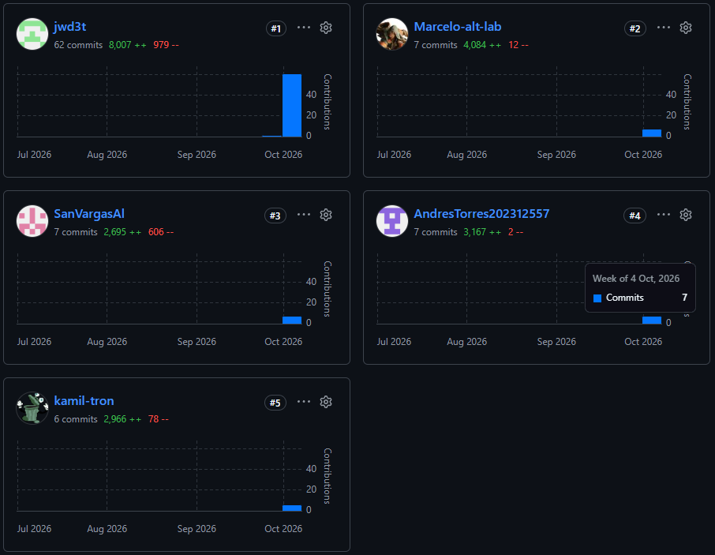


---


### 4.2.2. Sprint 2

#### 4.2.2.1. Sprint Planning 2

| Campo | Valor |
|---|---|
| Sprint | Sprint 2 |
| Fecha | 2026-10-10 |
| Hora | 18:00 |
| Ubicación | Virtual - Discord |
| Preparado por | Juan Wang |
| Asistentes | Marcelo Cuadros, Andres Torres, Juan Wang, Santiago Vargas, Kamil Diaz |
| Sprint Goal | **Nuestro foco está en** implementar el Bounded Context de **Diary** (Diario Personal en Markdown con auto-guardado debounced y persistencia Room SQLite offline-first sincronizada con REST), la alternancia visual e interactiva Diarito/Diario con selector superior estilo Grok, la visualización en galería de fotos de dos columnas con tarjetas cuadradas, la gestión de perfiles clínicos y contacto de emergencia, y la navegación horizontal fluida por pestañas. <br><br> **Creemos que esto habilitará** una experiencia clínica y reflexiva completa para el paciente, permitiéndole alternar instantáneamente entre el diálogo socrático guiado por IA y la redacción íntima y estructurada de sus notas sin riesgo de pérdida de datos. <br><br> **Esto se confirmará cuando** las pruebas unitarias y de integración de la aplicación móvil y del backend alcancen el 100% de éxito, los endpoints de `/api/v1/diary-entries` persistan y sincronicen notas en PostgreSQL y SQLite Room, y el build de Android se ejecute fluidamente en dispositivos reales y emuladores. |
| Velocity | 43 |
| Story Points incluidos | 62 |

##### Ampliación del alcance con la aplicación profesional

Para la entrega AV2 se incorpora **SafeDiary Clinical**, la aplicación para psicólogos desarrollada en Flutter y Dart en [SafeDiary_Flutter](https://github.com/MindClusterUPC/SafeDiary_Flutter/tree/develop). Los commits del 9 al 12 de noviembre complementan los avances del cliente Android del paciente y del backend ya registrados. El objetivo de esta ampliación es permitir al profesional gestionar disponibilidad, solicitudes, conversaciones y citas desde una aplicación propia, conectada a los mismos datos de `safediary-platform`.

El alcance incluye los destinos **Agenda, Pacientes y Pagos**, además de autenticación profesional, ficha y verificación, propuestas de horario, acceso autorizado a la sesión y consulta del resumen compartido. La aceptación de la propuesta y el pago de la cita corresponden al paciente. El diario permanece privado y el resumen requiere consentimiento vigente.

Los **62 Story Points** del backlog del paciente y del backend se mantienen como referencia de la planificación registrada. Los incrementos Flutter se registran por separado a continuación, sin asignarles estimaciones retrospectivas ni declarar completadas historias que también requieren trabajo en otros clientes o servicios.

#### 4.2.2.2. Aspect Leaders and Collaborators

| Team Member (Last Name, First Name) | GitHub Username | IAM Leader (L) / Collaborator (C) | Profile Leader (L) / Collaborator (C) | Diary Leader (L) / Collaborator (C) | AssistantAI Leader (L) / Collaborator (C) | Clinician Directory Leader (L) / Collaborator (C) | Care Scheduling Leader (L) / Collaborator (C) | Payment and Payouts Leader (L) / Collaborator (C) | Rutines Leader (L) / Collaborator (C) |
|---|---|:---:|:---:|:---:|:---:|:---:|:---:|:---:|:---:|
| Cuadros Villanueva, Marcelo Fabio | Marcelo-alt-lab | C | L | C | C | C | C | L | C |
| Diaz Martinez, Alexther Kamil | kamil-tron | C | C | C | C | L | C | C | C |
| Torres Lavandera, Andres Rodrigo | AndresTorres202312557 | L | C | C | C | C | L | C | C |
| Vargas Alarcon, Santiago Enrique | SanVargasAl | C | C | C | C | C | C | C | L |
| Wang Chen, Juan Sung Jau | jwd3t | C | C | L | L | C | C | C | C |

La implementación del cliente profesional Flutter estuvo a cargo de **Diaz Martinez, Alexther Kamil (`kamil-tron`)**, según los commits del repositorio. Esta contribución conecta las interfaces de agenda, pacientes y cobros con los contratos de Care Scheduling, Clinician Directory, IAM y Payments del backend compartido.

#### 4.2.2.3. Sprint Backlog 2

El Sprint Backlog 2 toma del Product Backlog las historias que cierran el primer ciclo de valor del paciente: crear su cuenta, escribir en su diario, conversar con Diarito, encontrar a un psicólogo, coordinar y reservar una cita, y seguir sus rutinas de autocuidado. Se comprometieron **62 Story Points**; cada historia se descompuso en Engineering Tasks de 4 a 8 horas, trazadas en Trello por los estados `To Do`, `In Process`, `To Review` y `Done`.

**URL del tablero:** [Sprint Backlog 2 en Trello](https://trello.com/b/mN57scXQ/mindcluster-sprint-2)

##### Tabla de User Stories del Sprint 2

Los identificadores y títulos corresponden al Product Backlog (sección 2.4.3). La columna *Estado* indica lo que quedó verificado en el código y en las pruebas al cierre del sprint.

| User Story ID | Título | Épica | Story Points | Alcance entregado en el Sprint 2 | Estado |
|---|---|---|---:|---|---|
| US-001 | Registro de cuenta | EP-01 | 3 | Registro e inicio de sesión contra IAM con token JWT; cada sesión queda aislada por cuenta, sin datos de otro usuario. | Done |
| US-006 | Edición del perfil personal | EP-01 | 2 | Edición de nombre, teléfono, foto de perfil, contacto de emergencia y cambio de correo con verificación de contraseña. | Done |
| US-008 | Registro de entrada de diario | EP-02 | 3 | Editor de diario con formato visual (título, negrita, cursiva, destacar y lista), preguntas guía, auto-guardado y galería de notas, offline-first con sincronización. | Done |
| US-010 | Registro rápido del estado emocional | EP-02 | 3 | Selector de ánimo en la pantalla de inicio. La persistencia del registro en el backend queda para el Sprint 3. | Parcial |
| US-011 | Reflexión guiada por voz con IA | EP-02 | 8 | Conversación reflexiva por texto con Diarito, varias sesiones e historial por cuenta. La entrada por voz queda para el Sprint 3. | Parcial |
| US-013 | Acceso inmediato a ayuda de crisis | EP-02 | 5 | Detección de señales de riesgo en la conversación y ofrecimiento de líneas de ayuda dentro del chat. | Done |
| US-002 | Búsqueda y consulta de psicólogos verificados | EP-04 | 5 | Directorio de psicólogos cargado desde la API, ficha profesional y calificación. | Done |
| US-048 | Solicitud de contacto y chat de coordinación | EP-06 | 8 | Solicitud de contacto al psicólogo y chat de coordinación con mensajes persistidos. | Done |
| US-043 | Gestión de solicitudes y agenda profesional | EP-06 | 5 | Agenda del psicólogo y decisión sobre las solicitudes recibidas. | Done |
| US-049 | Aceptación del horario propuesto | EP-06 | 3 | Propuesta de horario por el psicólogo y aceptación por el paciente. | Done |
| US-014 | Reserva temporal del horario acordado | EP-06 | 5 | Consulta de horarios disponibles y reserva de la cita acordada. | Done |
| US-037 | Pago seguro de una sesión | EP-07 | 8 | Cobro con Stripe Connect (destination charges y webhooks) en el backend, historial de pagos y métodos guardados en la app. El checkout dentro de la app queda para el Sprint 3. | Parcial |
| US-007 | Gestión de rutinas de autocuidado | EP-02 | 2 | Creación, edición, eliminación y marcado diario de rutinas, sincronizadas con el backend. | Done |
| US-030 | Ejercicios rápidos de regulación | EP-02 | 2 | Ejercicios SOS guiados paso a paso, con avance y cierre registrados. | Done |

De los 62 Story Points comprometidos, **43 quedaron en Done** y 19 en estado parcial (US-010, US-011 y US-037), que pasan al Sprint 3 con el alcance restante descrito. La historia US-015 *Desbloqueo biométrico* no se inició en este sprint: el perfil ya guarda la preferencia de bloqueo, pero falta la integración con `BiometricPrompt`, por lo que se replanifica para el Sprint 3.

##### Descomposición de Historias de Usuario en Engineering Tasks (Rango 4 a 8 horas)

| Task ID | User Story | Descripción de la Tarea de Ingeniería | Estimación (Horas) | Responsable | Estado |
|---|---|---|:---:|---|---|
| T-001-01 | US-001 | Modelar el dominio IAM (cuentas, consentimientos, auditoría) y sus servicios CQRS | 8h | Andres Torres | Done |
| T-001-02 | US-001 | Configurar seguridad JWT, cifrado BCrypt y controladores REST de IAM con pruebas de integración | 8h | Andres Torres | Done |
| T-001-03 | US-001 | Implementar el flujo de inicio de sesión y registro en Android con gestión de sesión | 6h | Marcelo Cuadros | Done |
| T-001-04 | US-001 | Restringir cada endpoint a la cuenta autenticada (403 entre cuentas) y aislar los datos locales por cuenta | 8h | Juan Wang | Done |
| T-001-05 | US-001 | Forzar registro como paciente y recuperar sesiones inválidas en la app | 4h | Kamil Diaz | Done |
| T-006-01 | US-006 | Exponer endpoints de actualización de perfil, contacto de emergencia y cambio de correo | 5h | Marcelo Cuadros | Done |
| T-006-02 | US-006 | Desarrollar la gestión de perfil en Android con confirmación y retroalimentación | 6h | Marcelo Cuadros | Done |
| T-006-03 | US-006 | Persistir la foto de perfil y compartir el avatar entre pantallas | 5h | Kamil Diaz | Done |
| T-008-01 | US-008 | Modelar el agregado DiaryEntry, comandos, queries y persistencia JPA en el backend | 6h | Juan Wang | Done |
| T-008-02 | US-008 | Implementar Room, Retrofit y el repositorio offline-first del diario en Android | 6h | Juan Wang | Done |
| T-008-03 | US-008 | Construir el editor de diario con formato visual, preguntas guía y auto-guardado | 8h | Juan Wang | Done |
| T-008-04 | US-008 | Diseñar la galería de notas en dos columnas con borrado confirmado | 5h | Juan Wang | Done |
| T-010-01 | US-010 | Integrar el selector de estado de ánimo en la pantalla de inicio | 4h | Kamil Diaz | Done |
| T-011-01 | US-011 | Persistir varias conversaciones con Diarito por cuenta y mostrarlas en el menú lateral | 6h | Juan Wang | Done |
| T-011-02 | US-011 | Aislar el historial heredado de conversaciones compartidas | 4h | Kamil Diaz | Done |
| T-013-01 | US-013 | Evaluar señales de riesgo en el backend y ofrecer líneas de ayuda en el chat | 6h | Juan Wang | Done |
| T-002-01 | US-002 | Construir las vistas del directorio y de la ficha profesional | 6h | Kamil Diaz | Done |
| T-002-02 | US-002 | Cargar los psicólogos desde la API de Clinician Directory | 5h | Andres Torres | Done |
| T-048-01 | US-048 | Implementar las vistas de solicitud de contacto y chat de coordinación | 6h | Kamil Diaz | Done |
| T-048-02 | US-048 | Conectar Care Scheduling con IAM para identidad y consentimiento | 6h | Andres Torres | Done |
| T-014-01 | US-014 | Conectar agenda, horarios disponibles y propuestas con el backend | 8h | Andres Torres | Done |
| T-014-02 | US-014 | Agregar horarios flexibles y la confirmación local de la reserva | 6h | Kamil Diaz | Done |
| T-037-01 | US-037 | Implementar Stripe Connect con destination charges y webhooks | 8h | Marcelo Cuadros | Done |
| T-037-02 | US-037 | Exponer y consumir historial de pagos y métodos guardados | 6h | Marcelo Cuadros | Done |
| T-007-01 | US-007 | Conectar las rutinas de la app con el backend de Rutines | 6h | Santiago Vargas | Done |
| T-007-02 | US-007 | Persistir la edición de horarios y el progreso diario de las rutinas | 6h | Kamil Diaz | Done |
| T-030-01 | US-030 | Integrar los ejercicios SOS guiados con el backend | 5h | Santiago Vargas | Done |
| T-TEST-01 | Transversal | Autenticar las pruebas de aceptación Karate con token IAM y agregar escenarios de aislamiento | 5h | Juan Wang | Done |

##### Incrementos del cliente profesional Flutter

Estos incrementos documentan el trabajo realizado en el cliente profesional y su relación con las historias del Product Backlog. El estado corresponde al alcance Flutter descrito, no al cierre completo de cada historia entre todos los componentes de la solución.

| Incremento | Historias relacionadas | Alcance implementado en Flutter | Responsable | Estado del alcance |
|---|---|---|---|---|
| FL-01 | US-001, US-036, US-041 | Acceso y registro con rol `PSYCHOLOGIST`, sesión segura, edición de ficha y tarifa, consulta y solicitud de verificación, publicación y ocultación del perfil. | Kamil Diaz | Implementado; la aprobación de credenciales corresponde al personal autorizado. |
| FL-02 | US-043 | Calendario semanal, selección de fecha, consulta de citas y edición de disponibilidad semanal con confirmación de reemplazo. | Kamil Diaz | Implementado en el cliente profesional. |
| FL-03 | US-043, US-048 | Solicitudes de contacto, aceptación o rechazo, filtros de pacientes, chat de coordinación y envío de propuestas con horarios del servidor. | Kamil Diaz | Implementado; aceptación del horario y pago desde el paciente. |
| FL-04 | US-038, US-044, US-050 | Detalle de cita, cancelación, consulta del estado de sesión, apertura de videollamada autorizada y cierre operativo. | Kamil Diaz | Interfaces implementadas; el servidor valida estado y ventana de acceso. |
| FL-05 | US-045, US-046 | Consulta a demanda del resumen autorizado y su alcance, sin descargar el diario ni conservar el resumen en disco. | Kamil Diaz | Implementado con consentimiento vigente validado por el backend. |
| FL-06 | US-047, US-052 | Consulta del estado de Stripe Connect, apertura del onboarding y edición de la tarifa de la ficha. | Kamil Diaz | Parcial: no incluye saldo, historial de ingresos ni solicitudes de retiro. |

#### 4.2.2.4. Development Evidence for Sprint Review

En el backend y el cliente Android del paciente, cada historia se trabajó en su propia rama `feature/*` o `fix/*` y se integró a `develop` con `--no-ff`, siguiendo Conventional Commits. La tabla resume los commits principales de cada integrante. Los commits del cliente profesional Flutter se presentan en una tabla independiente.

| Repositorio | Commit | Mensaje de Commit | Autor | Fecha | User Story |
|---|---|---|---|---|---|
| safediary-platform | [`223937c`](https://github.com/MindClusterUPC/safediary-platform/commit/223937c) | feat(iam): implement jwt security, bcrypt hashing, federated sign-in and jpa persistence | Andres Torres | 2026-10-12 | US-001 |
| safediary-platform | [`b77e47a`](https://github.com/MindClusterUPC/safediary-platform/commit/b77e47a) | test(iam): add domain and api integration tests | Andres Torres | 2026-10-12 | US-001 |
| safediary-platform | [`a931dfa`](https://github.com/MindClusterUPC/safediary-platform/commit/a931dfa) | feat(care-scheduling): use IAM for identity and consent | Andres Torres | 2026-11-08 | US-048, US-014 |
| safediary-platform | [`0b39904`](https://github.com/MindClusterUPC/safediary-platform/commit/0b39904) | feat(profiles): link IAM account registration and project Payments subscription status in Patient profile | Marcelo Cuadros | 2026-10-28 | US-001, US-006 |
| safediary-platform | [`68fa740`](https://github.com/MindClusterUPC/safediary-platform/commit/68fa740) | feat(payments): implement Stripe Connect marketplace, destination charges, dual webhook secrets and event deserialization | Marcelo Cuadros | 2026-10-31 | US-037 |
| safediary-platform | [`182a3d3`](https://github.com/MindClusterUPC/safediary-platform/commit/182a3d3) | feat(profiles): add update profile, emergency contact deletion and email change with password verification | Marcelo Cuadros | 2026-11-04 | US-006 |
| safediary-platform | [`00b57c9`](https://github.com/MindClusterUPC/safediary-platform/commit/00b57c9) | feat(payments): add patient transaction history and saved payment methods query endpoints | Marcelo Cuadros | 2026-11-04 | US-037 |
| safediary-platform | [`612000e`](https://github.com/MindClusterUPC/safediary-platform/commit/612000e) | feat(diary): implement markdown diary domain aggregate, commands, queries, and repository port | Juan Wang | 2026-11-06 | US-008 |
| safediary-platform | [`980a5ef`](https://github.com/MindClusterUPC/safediary-platform/commit/980a5ef) | fix(security): scope assistant, profiles, rutines and diary endpoints to the signed-in account | Juan Wang | 2026-11-08 | US-001 |
| safediary-platform | [`8cf45fa`](https://github.com/MindClusterUPC/safediary-platform/commit/8cf45fa) | fix(security): scope patient subscriptions, payment history and methods to the signed-in account | Juan Wang | 2026-11-08 | US-001, US-037 |
| safediary-platform | [`dce4020`](https://github.com/MindClusterUPC/safediary-platform/commit/dce4020) | fix(assistant): quarantine legacy shared conversation history | Kamil Diaz | 2026-11-09 | US-011 |
| safediary-platform | [`fe3c2d4`](https://github.com/MindClusterUPC/safediary-platform/commit/fe3c2d4) | feat(routines): persist editable schedules and daily completion | Kamil Diaz | 2026-11-09 | US-007 |
| SafeDiary-Android | [`874b6ee`](https://github.com/MindClusterUPC/SafeDiary-Android/commit/874b6ee) | feat(iam): implement minimal authentication flow and session management | Marcelo Cuadros | 2026-11-04 | US-001 |
| SafeDiary-Android | [`e3a4e4c`](https://github.com/MindClusterUPC/SafeDiary-Android/commit/e3a4e4c) | feat(profiles): implement patient profile management, emergency contact and email update with master password | Marcelo Cuadros | 2026-11-04 | US-006 |
| SafeDiary-Android | [`470a613`](https://github.com/MindClusterUPC/SafeDiary-Android/commit/470a613) | feat(payments): implement patient payments history and saved payment methods bounded context | Marcelo Cuadros | 2026-11-04 | US-037 |
| SafeDiary-Android | [`b7e7c69`](https://github.com/MindClusterUPC/SafeDiary-Android/commit/b7e7c69) | feat(home): add mood check-in and patient screen previews | Kamil Diaz | 2026-11-04 | US-010 |
| SafeDiary-Android | [`a51decd`](https://github.com/MindClusterUPC/SafeDiary-Android/commit/a51decd) | feat(psychologist): add local directory and professional profiles | Kamil Diaz | 2026-11-04 | US-002 |
| SafeDiary-Android | [`2936483`](https://github.com/MindClusterUPC/SafeDiary-Android/commit/2936483) | feat(scheduling): add local appointment and coordination flows | Kamil Diaz | 2026-11-04 | US-048, US-049 |
| SafeDiary-Android | [`ad9b491`](https://github.com/MindClusterUPC/SafeDiary-Android/commit/ad9b491) | feat(rutines): connection to backend | Santiago Vargas | 2026-11-05 | US-007, US-030 |
| SafeDiary-Android | [`c122190`](https://github.com/MindClusterUPC/SafeDiary-Android/commit/c122190) | feat(rutines): testing connection to backend | Santiago Vargas | 2026-11-07 | US-007, US-030 |
| SafeDiary-Android | [`887bbd4`](https://github.com/MindClusterUPC/SafeDiary-Android/commit/887bbd4) | feat(diary): add domain model, Room persistence, Retrofit gateway, and aggregate unit tests | Juan Wang | 2026-11-06 | US-008 |
| SafeDiary-Android | [`4b04814`](https://github.com/MindClusterUPC/SafeDiary-Android/commit/4b04814) | feat(professionals): load clinicians from the directory API | Andres Torres | 2026-11-08 | US-002 |
| SafeDiary-Android | [`1da4e9a`](https://github.com/MindClusterUPC/SafeDiary-Android/commit/1da4e9a) | feat(scheduling): connect care scheduling to the backend | Andres Torres | 2026-11-08 | US-014, US-043, US-049 |
| SafeDiary-Android | [`fc9f6b0`](https://github.com/MindClusterUPC/SafeDiary-Android/commit/fc9f6b0) | fix(iam): never fall back to another account and isolate local data per account | Juan Wang | 2026-11-08 | US-001 |
| SafeDiary-Android | [`155e98a`](https://github.com/MindClusterUPC/SafeDiary-Android/commit/155e98a) | feat(diary): journal-friendly editor with visual formatting and writing prompts | Juan Wang | 2026-11-08 | US-008 |
| SafeDiary-Android | [`c7206f3`](https://github.com/MindClusterUPC/SafeDiary-Android/commit/c7206f3) | feat(routines): support persistent editing deletion and daily progress | Kamil Diaz | 2026-11-09 | US-007 |
| SafeDiary-Android | [`b979941`](https://github.com/MindClusterUPC/SafeDiary-Android/commit/b979941) | feat(profile): persist account photos and share avatars across screens | Kamil Diaz | 2026-11-09 | US-006 |

##### Evidencia de desarrollo de SafeDiary Clinical

Repositorio: [MindClusterUPC/SafeDiary_Flutter](https://github.com/MindClusterUPC/SafeDiary_Flutter), rama `develop`. La siguiente tabla registra commits existentes del cliente profesional, cuyo autor es `kamil-tron`.

| Commit | Mensaje de commit | Fecha | Incremento documentado |
|---|---|---|---|
| [`201f898`](https://github.com/MindClusterUPC/SafeDiary_Flutter/commit/201f898) | feat(app): bootstrap the Flutter psychologist application | 2026-11-09 | Inicio del cliente profesional con autenticación, agenda, pacientes, chat, perfil y cobros. |
| [`4394b3f`](https://github.com/MindClusterUPC/SafeDiary_Flutter/commit/4394b3f) | refactor(shared): centralize session, profile, and UI foundations | 2026-11-09 | Sesión, ficha profesional, cliente HTTP y componentes compartidos. |
| [`037fa0d`](https://github.com/MindClusterUPC/SafeDiary_Flutter/commit/037fa0d) | refactor(agenda): isolate scheduling models, repository, and views | 2026-11-09 | Módulo de agenda, disponibilidad, propuestas y atención. |
| [`e749bca`](https://github.com/MindClusterUPC/SafeDiary_Flutter/commit/e749bca) | refactor(patients): isolate contact requests and coordination chat | 2026-11-09 | Módulo de solicitudes, pacientes y conversaciones. |
| [`48c3a21`](https://github.com/MindClusterUPC/SafeDiary_Flutter/commit/48c3a21) | refactor(payments): isolate connected accounts and payout views | 2026-11-09 | Módulo de estado de cuenta conectada y configuración de cobros; no acredita retiros implementados. |
| [`978850b`](https://github.com/MindClusterUPC/SafeDiary_Flutter/commit/978850b) | test(architecture): verify context isolation and document module boundaries | 2026-11-09 | Pruebas de separación por contexto y documentación de contratos. |
| [`918940b`](https://github.com/MindClusterUPC/SafeDiary_Flutter/commit/918940b) | fix(chat): keep schedule actions docked above the composer | 2026-11-12 | Acciones de coordinación visibles sobre el campo de mensaje, también con el teclado abierto. |

La estructura del cliente separa `agenda`, `patients` y `payments` en modelos y contratos de dominio, adaptadores REST y presentación con modelos de vista. `shared` contiene identidad, perfil, almacenamiento seguro de sesión y UI; `app` compone los módulos. Las dependencias y los límites se describen en [BOUNDED_CONTEXTS.md](https://github.com/MindClusterUPC/SafeDiary_Flutter/blob/develop/docs/BOUNDED_CONTEXTS.md).

#### 4.2.2.5. Testing Suite Evidence for Sprint Review

Al cierre del sprint, ambas suites se ejecutan sin fallos sobre la rama `develop`.

- **Backend** (`./mvnw verify`): **158 pruebas** entre unitarias (JUnit 5 y Mockito), de integración (Spring Boot Test) y de aceptación (Karate), con **64,3 % de cobertura de líneas** medida con JaCoCo. Las pruebas Karate se autentican con un token IAM real y agregan escenarios que comprueban que una cuenta no puede leer los datos de otra (respuesta 403).
- **Aplicación móvil** (`./gradlew testDebugUnitTest`): **58 pruebas unitarias** con JUnit 4, todas aprobadas.

| Componente | Tipo de Prueba | Clase / Suite de Pruebas | Casos | Resultado |
|---|---|---|:---:|:---:|
| Mobile · Diary | Unitaria (formato del editor) | `DiaryMarkupTest` | 9 | Aprobado |
| Mobile · Diary | Unitaria (agregado) | `DiaryEntryAggregateTest` | 4 | Aprobado |
| Mobile · AssistantAI | Unitaria (sesión y personalidad) | `AiConversationAggregateTest`, `DiaritoPersonalityTest`, `OfflineChatTest` | 18 | Aprobado |
| Mobile · IAM | Unitaria (sesión y aislamiento) | `AuthenticationSessionTest`, `AccountBoundaryTest` | 12 | Aprobado |
| Mobile · Patient | Unitaria (rutinas y vistas) | `PatientPreviewTest`, `RoutineManagementTest` | 14 | Aprobado |
| Backend · IAM | Dominio e integración | `AccountTest`, `ConsentTest`, `IamApiIntegrationTest` | 15 | Aprobado |
| Backend · AssistantAI | Unitaria, integración y Karate | `ConversationSessionTest`, `RiskPolicyServiceTest`, `ChatAccountIsolationIntegrationTest`, `AssistantAiKarateTest` y otras | 51 | Aprobado |
| Backend · Clinician Directory | Integración y Karate | `DirectoryApiIntegrationTest`, `ClinicianDirectoryKarateTest` | 15 | Aprobado |
| Backend · Care Scheduling | Dominio e integración | `AppointmentTest`, `BookableSlotCalculatorTest`, `CareSchedulingApiIntegrationTest`, `IamContextClientTest` | 17 | Aprobado |
| Backend · Profiles | Unitaria y Karate | `ProfileCommandServiceImplTest`, `ProfileQueryServiceImplTest`, `ProfilesKarateTest` | 17 | Aprobado |
| Backend · Rutines | Unitaria, integración y Karate | `RoutineCommandServiceImplTest`, `RoutineQueryServiceImplTest`, `RoutineAccountIsolationIntegrationTest`, `RoutinesKarateTest` | 19 | Aprobado |
| Backend · Payments | Dominio y unitaria | `SubscriptionTest`, `SubscriptionCommandServiceTest`, `MarketplaceConnectPaymentsTest` | 16 | Aprobado |

##### Verificación automatizada del cliente Flutter

El **13/11/2026** se ejecutó `flutter test --reporter expanded` sobre el cliente profesional en el commit `918940b`. El resultado fue **15 pruebas aprobadas**, con el mensaje `All tests passed!`.

| Suite | Casos aprobados | Comportamiento verificado |
|---|:---:|---|
| [api_and_session_test.dart](https://github.com/MindClusterUPC/SafeDiary_Flutter/blob/918940b/test/api_and_session_test.dart) | 8 | Hora de Lima, rol profesional, token Bearer, contratos de propuestas y disponibilidad, respuestas de sesiones anteriores, limpieza por 401 y ventana de acceso a la cita. |
| [bounded_contexts_test.dart](https://github.com/MindClusterUPC/SafeDiary_Flutter/blob/918940b/test/bounded_contexts_test.dart) | 4 | Aislamiento de módulos, actualización independiente ante errores, limpieza al salir y descarte de resultados de fechas anteriores. |
| [clinical_ui_test.dart](https://github.com/MindClusterUPC/SafeDiary_Flutter/blob/918940b/test/clinical_ui_test.dart) | 3 | Navegación en teléfono pequeño, acceso y registro con texto ampliado y acciones del chat visibles con y sin teclado. |
| **Total** | **15** | **Todas aprobadas.** |

Las pruebas anteriores usan datos de prueba y un cliente HTTP simulado; no acreditan cobros reales ni una sesión de videollamada completa. El repositorio también contiene [clinical_app_test.dart](https://github.com/MindClusterUPC/SafeDiary_Flutter/blob/develop/integration_test/clinical_app_test.dart), una prueba de navegación contra el backend para acceso, agenda, pacientes, chat, pagos y perfil. Las capturas conservadas de ese recorrido se presentan en la siguiente sección; esta actualización no declara una nueva ejecución de esa prueba de integración.

#### 4.2.2.6. Execution Evidence for Sprint Review

La aplicación muestra el recorrido principal del paciente conectado al backend:

1. **Cuenta propia y aislada.** El paciente se registra o inicia sesión con IAM. Cada cuenta ve solo su perfil, su diario y sus conversaciones; si en el mismo dispositivo inicia sesión otra persona, los datos locales anteriores se eliminan antes de mostrar nada.
2. **Diario con formato visual.** El editor no muestra símbolos técnicos: el paciente elige *Título*, *Negrita*, *Cursiva*, *Destacar* o *Lista* y ve el texto ya formateado mientras escribe. Con la página en blanco aparecen preguntas guía como "¿Qué pasó hoy?" o "Algo que agradezco". Las notas se guardan solas y se listan en una galería de dos columnas.
3. **Diarito.** El paciente conversa por texto con el asistente, abre varias sesiones desde el menú lateral y, ante señales de riesgo, recibe las líneas de ayuda.
4. **Psicólogos y citas.** El paciente consulta el directorio, abre la ficha de un psicólogo, envía una solicitud de contacto, conversa en el chat de coordinación, acepta el horario propuesto y reserva la cita.
5. **Autocuidado.** El paciente crea y edita rutinas, marca su avance diario y realiza ejercicios SOS guiados.
6. **Perfil y pagos.** El paciente edita sus datos, foto y contacto de emergencia, y consulta su historial de pagos y métodos guardados.

| Pantalla / Funcionalidad | Descripción de la ejecución | Entorno | Resultado |
|---|---|---|:---:|
| Registro e inicio de sesión | Una cuenta nueva muestra solo su propio perfil e historial vacío | Emulador Android | Exitoso |
| Editor de diario | Formato visual sin símbolos, preguntas guía y auto-guardado | Emulador Android | Exitoso |
| Galería de notas | Notas en dos columnas con extracto en texto plano y borrado confirmado | Emulador Android | Exitoso |
| Diarito | Varias sesiones por cuenta y ofrecimiento de ayuda ante riesgo | Emulador Android | Exitoso |
| Directorio y citas | Solicitud de contacto, chat de coordinación, propuesta y reserva | Emulador Android | Exitoso |
| Rutinas y ejercicios SOS | Edición, eliminación y progreso diario sincronizados | Emulador Android | Exitoso |

##### Ejecución de la aplicación profesional Flutter

Las siguientes capturas proceden de la aplicación ejecutada en Android con una **cuenta profesional ficticia de prueba**. Muestran los datos del entorno de desarrollo y complementan las evidencias del cliente Android del paciente.

**Agenda clínica.** El profesional selecciona un día, consulta sus citas y accede a la próxima atención. Los horarios se presentan en hora de Lima y la disponibilidad se configura desde este destino. En la captura, el día seleccionado no tiene citas y la próxima atención aparece por separado.

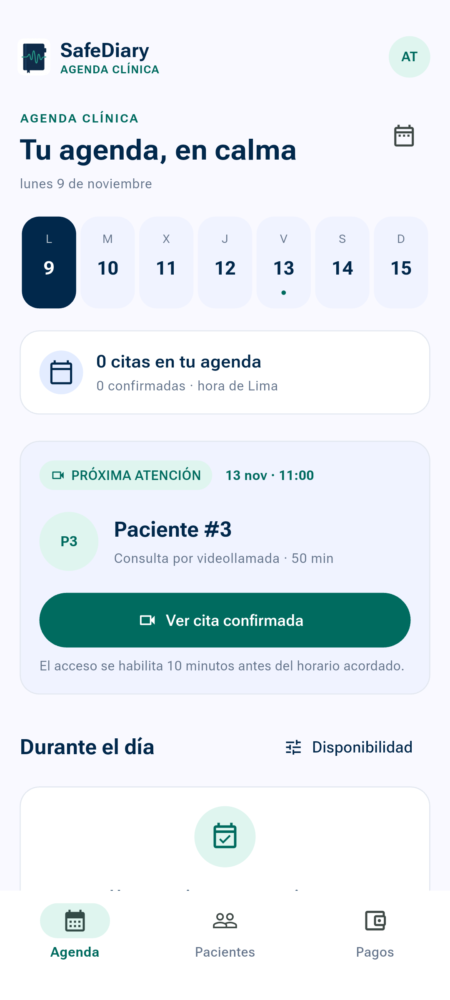

**Pacientes y solicitudes.** La aplicación permite alternar entre contactos activos, solicitudes y conversaciones archivadas. Los pacientes se identifican por su ID; la pantalla no consulta sus nombres privados ni concede acceso al diario.

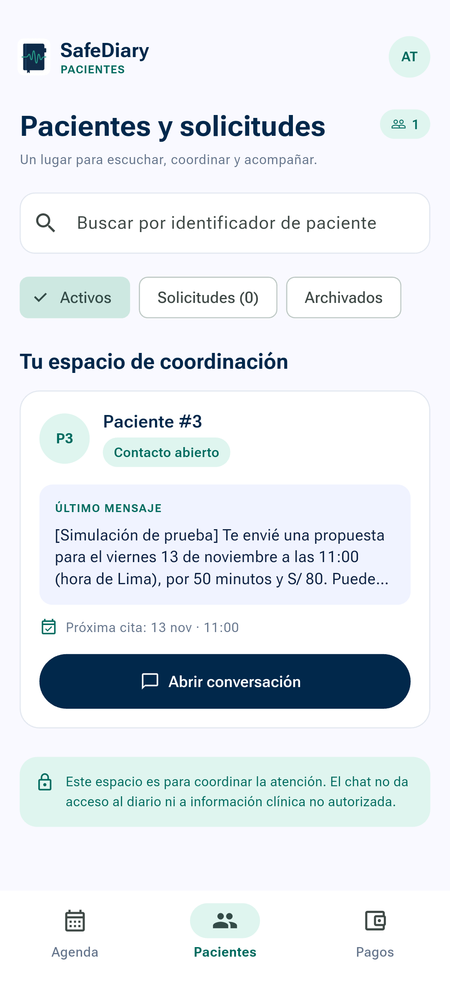

**Chat de coordinación.** La conversación reúne los mensajes del contacto y una tarjeta con el estado de la cita. Los mensajes marcados como simulación pertenecen al entorno de prueba. El profesional propone horarios; la aceptación y el pago se completan desde la app del paciente. El ajuste del commit `918940b` mantiene las acciones sobre el compositor cuando corresponden al estado de la conversación.

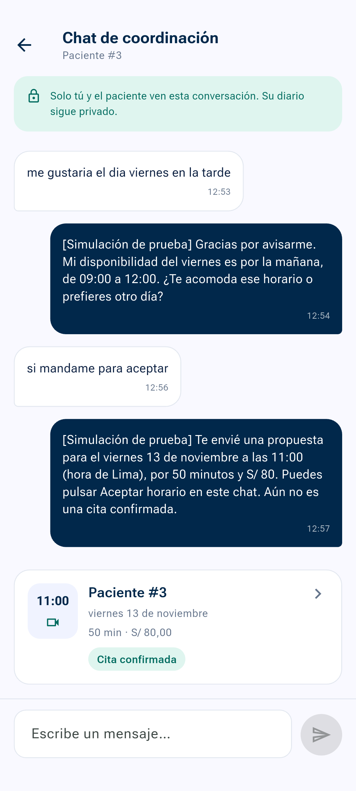

**Pagos.** Se consulta el estado de la cuenta conectada y se ofrece configurar cobros con Stripe Connect. La captura muestra el estado real de la cuenta de prueba, **Por configurar**, y la tarifa pública. No presenta un saldo, un historial de ingresos ni retiros disponibles.

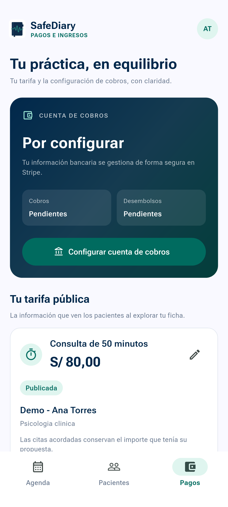

**Perfil profesional.** La ficha muestra especialidad, tarifa y estados de verificación y publicación de la cuenta de demostración. Permite editar la ficha, consultar la verificación y ocultar la publicación, conservando el diario del paciente fuera del acceso automático del profesional.

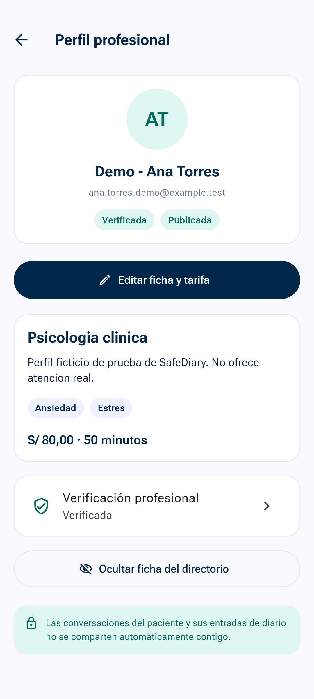

Las interfaces de atención consultan el estado de la cita antes de abrir la URL de videollamada en el navegador. El resumen autorizado se obtiene a demanda, se descarta al pasar a segundo plano y se vuelve a validar al regresar. Estas acciones dependen de las reglas de acceso y del consentimiento que verifica el servidor; las capturas anteriores no constituyen evidencia de una llamada completada ni de un cobro de producción.

#### 4.2.2.7. Services Documentation Evidence for Sprint Review

El backend `v0.4.0` está desplegado en Render con una base PostgreSQL en Neon, que reemplazó a filess.io porque su plan gratuito solo permitía 10 MB. Todos los servicios se documentan con OpenAPI y se pueden probar en Swagger UI ([https://safediary-platform.onrender.com/swagger-ui/index.html](https://safediary-platform.onrender.com/swagger-ui/index.html)). Los endpoints privados requieren el encabezado `Authorization: Bearer <token>` y responden `401` sin token y `403` cuando el recurso pertenece a otra cuenta. Los servicios incorporados o modificados en el Sprint 2 son:

| Bounded Context | Método | Ruta | Descripción | Respuesta esperada |
|---|---|---|---|---|
| IAM | POST | `/api/v1/authentication/sign-up` | Registra una cuenta de paciente | `201 Created` con token y datos de la cuenta |
| IAM | POST | `/api/v1/authentication/sign-in` | Inicia sesión | `200 OK` con token JWT |
| Profiles | GET | `/api/v1/patients/me` | Perfil del paciente autenticado | `200 OK` |
| Profiles | PUT | `/api/v1/patients/{id}`, `/api/v1/patients/{id}/email`, `/api/v1/patients/{id}/emergency-contact` | Actualiza perfil, correo y contacto de emergencia propios | `200 OK` o `403 Forbidden` si no es propio |
| Diary | POST | `/api/v1/diary-entries` | Crea una nota del diario | `201 Created` |
| Diary | GET | `/api/v1/diary-entries/patient/{patientId}` | Lista las notas del paciente | `200 OK` |
| Diary | PUT / DELETE | `/api/v1/diary-entries/{id}` | Edita o elimina una nota propia | `200 OK` / `204 No Content` |
| AssistantAI | GET | `/api/v1/assistant/conversations` | Conversaciones de Diarito de la cuenta autenticada | `200 OK` |
| Clinician Directory | GET | `/api/v1/clinicians`, `/api/v1/clinicians/{id}` | Directorio y ficha profesional | `200 OK` |
| Care Scheduling | POST | `/api/v1/contact-requests`, `/api/v1/contact-requests/{id}/messages` | Solicitud de contacto y chat de coordinación | `201 Created` |
| Care Scheduling | GET | `/api/v1/schedule/clinicians/{clinicianId}/slots` | Horarios disponibles del psicólogo | `200 OK` |
| Care Scheduling | POST | `/api/v1/schedule/proposals`, `/api/v1/schedule/proposals/{appointmentId}/acceptance` | Propuesta y aceptación del horario | `201 Created` / `200 OK` |
| Rutines | POST / PUT / DELETE | `/api/v1/daily-routines`, `/api/v1/daily-routines/{id}` | Gestión de rutinas | `201 Created` / `200 OK` / `204 No Content` |
| Rutines | POST | `/api/v1/daily-routines/{id}/completion` | Marca el avance diario | `200 OK` |
| Rutines | PATCH | `/api/v1/sos-exercises/{id}/advance`, `/api/v1/sos-exercises/{id}/complete` | Avance y cierre de un ejercicio SOS | `200 OK` |
| Payments | GET | `/api/v1/payments/history`, `/api/v1/payments/methods` | Historial y métodos guardados del paciente | `200 OK` |

##### Contratos consumidos por el cliente profesional

Flutter consume la misma API REST que la app del paciente y envía `Authorization: Bearer <token>`. La documentación del contrato y sus límites está disponible en [API_CONTRACT.md](https://github.com/MindClusterUPC/SafeDiary_Flutter/blob/develop/docs/API_CONTRACT.md). La tabla identifica contratos usados por el cliente; no implica que todos los endpoints se hayan creado durante este sprint.

| Flujo profesional | Métodos y rutas principales | Condición de uso |
|---|---|---|
| Identidad, ficha y verificación | `POST /api/v1/authentication/sign-in`, `POST /api/v1/authentication/sign-up`, `GET /api/v1/clinicians/me`, `POST /api/v1/clinicians/{id}/verification-requests` | Cuenta profesional autenticada; el servidor decide la aprobación de credenciales. |
| Solicitudes y conversación | `GET /api/v1/contact-requests`, `PATCH /api/v1/contact-requests/{id}/decision`, `GET / POST /api/v1/contact-requests/{id}/messages` | Contactos de la cuenta autenticada; sin acceso al diario. |
| Disponibilidad y propuestas | `GET /api/v1/schedule/agenda`, `PUT /api/v1/schedule/availability`, `GET /api/v1/schedule/clinicians/{id}/slots`, `POST /api/v1/schedule/proposals` | Disponibilidad del servidor, control de conflictos e instantes enviados en UTC. |
| Atención y cancelación | `GET /api/v1/appointments/{id}/session`, `POST /api/v1/appointments/{id}/session/access`, `POST /api/v1/appointments/{id}/session/closure`, `POST /api/v1/appointments/{id}/cancellation` | Estado de cita, participantes y ventana temporal validados por el servidor. |
| Contexto compartido | `GET /api/v1/appointments/{id}/authorized-summary` | Consentimiento explícito y vigente; sin descarga del diario completo. |
| Cuenta de cobros | `GET /api/v1/payments/connect/accounts/{accountId}`, `POST /api/v1/payments/connect/accounts` | Configuración de Stripe Connect en el backend; no hay contratos de saldo, historial ni retiro profesional. |

#### 4.2.2.8. Software Deployment Evidence for Sprint Review

| Componente | Plataforma | Versión | Estado | Verificación |
|---|---|---|:---:|---|
| Backend RESTful API | Render (Docker) + PostgreSQL en Neon | [`v0.4.0`](https://github.com/MindClusterUPC/safediary-platform/releases/tag/v0.4.0) | En línea | [Swagger UI](https://safediary-platform.onrender.com/swagger-ui/index.html) responde; prueba de humo en producción el 12/11/2026: registro `201`, `GET /patients/me` `200`, acceso a datos de otra cuenta `403`, sin token `401` |
| Aplicación móvil | Android (APK) | `develop` | Compilado | APK de depuración generado y probado en emulador; la distribución a validadores se hará por Firebase App Distribution |
| SafeDiary Clinical para psicólogos | Flutter en Android | `1.0.0+1` / pruebas locales | APK de pruebas | APK debug disponible y capturas de ejecución; no se declara publicación en tienda ni en Firebase App Distribution. |
| Landing Page | GitHub Pages | `main` (`6ddb5ae`) | En línea | [https://mindclusterupc.github.io/SafeDiary_Landing_Page/](https://mindclusterupc.github.io/SafeDiary_Landing_Page/) responde `200 OK` |

El cliente Flutter utiliza un identificador Android distinto al del paciente y se instala como aplicación independiente. La configuración de URL, firma y proveedores externos se detalla en la sección 4.1.4. La evidencia local incluye el APK debug en `build/app/outputs/flutter-apk/app-debug.apk`; este binario generado no se incorpora al repositorio de documentación.

#### 4.2.2.9. Team Collaboration Insights during Sprint

El equipo trabajó con una rama por historia o corrección, integradas a `develop` con `--no-ff`. Entre la versión del Sprint 1 y el cierre del Sprint 2, los cinco integrantes registraron commits en los repositorios de código:

| Integrante | Commits en safediary-platform | Commits en SafeDiary-Android | Foco principal |
|---|:---:|:---:|---|
| Torres Lavandera, Andres Rodrigo | 11 | 4 | IAM, conexión de Directory y Care Scheduling |
| Cuadros Villanueva, Marcelo Fabio | 12 | 7 | Profiles, Payments y autenticación en la app |
| Diaz Martinez, Alexther Kamil | 5 | 10 | Vistas del paciente, citas, rutinas y fotos de perfil |
| Vargas Alarcon, Santiago Enrique | 0 | 3 | Conexión de rutinas y ejercicios SOS |
| Wang Chen, Juan Sung Jau | 13 | 23 | Diary, AssistantAI, aislamiento por cuenta y pruebas |

El principal aprendizaje del sprint fue la integración: varias funcionalidades se construyeron primero con datos locales y luego se conectaron al backend, lo que expuso que algunos endpoints aceptaban identificadores enviados por el cliente. El equipo corrigió esto restringiendo cada endpoint a la cuenta autenticada y lo cubrió con pruebas de aislamiento.

Durante el Sprint 2 se registraron avances en el backend, el cliente Android del paciente y el nuevo cliente Flutter del psicólogo. Las evidencias del backend y de Android se muestran en sus tablas de commits; la aplicación profesional incorpora siete commits de `kamil-tron`, del 9 al 12 de noviembre, disponibles en `develop`. Esta trazabilidad identifica los aportes sin asumir una distribución equitativa del trabajo ni un mecanismo de integración no acreditado para Flutter.

En el cliente profesional, Kamil Diaz implementó la aplicación inicial, separó los módulos de Agenda, Pacientes y Pagos, incorporó pruebas de aislamiento y ajustó las acciones del chat con el teclado. La integración reutiliza los contratos del backend del equipo y mantiene separados los datos personales del paciente y las tareas clínicas. Los límites de cobros, consentimiento y verificación se documentan junto a las funciones para distinguir el incremento entregado de las capacidades aún pendientes.

## 4.3. Validation Interviews

### 4.3.1. Diseño de Entrevistas

Las entrevistas de validación buscan confirmar que el recorrido principal de SafeDiary es comprensible y útil para los dos segmentos objetivo. Cada entrevistado usa la aplicación instalada desde Firebase App Distribution mientras comparte pantalla, sin ayuda del entrevistador salvo que se bloquee.

| Aspecto | Paciente | Psicólogo |
|---|---|---|
| Perfil | Persona de 18 a 35 años que ha buscado o considera buscar apoyo psicológico | Psicólogo colegiado con práctica privada o en línea |
| Cantidad | 3 entrevistas | 2 entrevistas |
| Duración | 20 a 30 minutos | 20 a 30 minutos |
| Modalidad | Virtual (Meet o Teams), grabada con consentimiento | Virtual (Meet o Teams), grabada con consentimiento |

**Tareas para el paciente**

1. Crear una cuenta y revisar su perfil.
2. Escribir una nota en el diario usando al menos un formato y una pregunta guía.
3. Conversar con Diarito y abrir una nueva sesión.
4. Buscar un psicólogo, enviar una solicitud de contacto y reservar una cita.
5. Crear una rutina de autocuidado y marcarla como realizada.

**Tareas para el psicólogo**

1. Revisar las solicitudes de contacto recibidas.
2. Responder en el chat de coordinación y proponer un horario.
3. Revisar su agenda con la cita confirmada.

**Preguntas posteriores**

1. ¿Qué fue lo más fácil y lo más difícil de lo que hiciste?
2. ¿Hubo algún momento en que no supiste qué hacer? ¿Cuál?
3. ¿Sentiste que tus notas y conversaciones eran privadas? ¿Por qué?
4. ¿Usarías el diario y a Diarito entre sesiones con tu psicólogo? ¿Con qué frecuencia?
5. ¿Qué cambiarías o agregarías?

### 4.3.2. Registro de Entrevistas

Cada entrevista se registra con la siguiente ficha. Las entrevistas se realizan durante el Sprint 3 y sus fichas se completan con la grabación y los resultados.

| Campo | Valor |
|---|---|
| Entrevistado | Nombre y apellido |
| Segmento | Paciente o psicólogo |
| Edad / Distrito | |
| Fecha y duración | |
| Entrevistador | |
| Enlace a la grabación | |
| Tareas completadas sin ayuda | |
| Principales hallazgos | |

| Campo | Valor |
|---|---|
| Entrevistado | José Asto |
| Segmento | Paciente |
| Edad / Distrito | 20 años, San Miguel|
| Fecha y duración |13/11/2026 / 07:57|
| Entrevistador |Kamil |
| Enlace a la grabación |https://upcedupe-my.sharepoint.com/:v:/g/personal/u202412316_upc_edu_pe/IQCw3-vVH8CMSrNBGjcoUU_oAUPiDtfk1T7GePS3m02U2qc?e=hbKSPv&nav=eyJyZWZlcnJhbEluZm8iOnsicmVmZXJyYWxBcHAiOiJTdHJlYW1XZWJBcHAiLCJyZWZlcnJhbFZpZXciOiJTaGFyZURpYWxvZy1MaW5rIiwicmVmZXJyYWxBcHBQbGF0Zm9ybSI6IldlYiIsInJlZmVycmFsTW9kZSI6InZpZXcifX0%3D |
| Tareas completadas sin ayuda | El entrevistador navegó y explicó la aplicación; el entrevistado solo respondió preguntas.|
| Principales hallazgos |Lo más fácil fue el apartado de "notas". Lo más difícil fue entender completamente la funcionalidad de "rutinas". Sugirió agregar videollamadas con psicólogos directamente en la aplicación. Considera útil la IA "diarito" como recordatorio y complemento a la terapia. |

| Campo | Valor |
|---|---|
| Entrevistado | Gabriel Ramirez Gutierrez |
| Segmento | Paciente |
| Edad / Distrito | 19 años, Puente Piedra |
| Fecha y duración | 12/11/2026 / 05:39|
| Entrevistador | Santiago |
| Enlace a la grabación | https://upcedupe-my.sharepoint.com/:v:/g/personal/u202412316_upc_edu_pe/IQD6mGtFEBafTaZT7Q5ZX12EAbvGxgIXGwXhcFjE-6b_M28?e=dMU3CO|
| Tareas completadas sin ayuda |No se muestra interacción con la aplicación, el entrevistado responde preguntas sobre su experiencia previa con ella. |
| Principales hallazgos | Tuvo confusión inicial con las opciones de la app y sugirió un pequeño tutorial. Cree que se necesita una confirmación de que la información otorgada a la IA no esta siendo usada para alimentarla y se mantiene en privado. Le gustaría un modo oscuro |

### 4.3.3. Evaluaciones según heurísticas

Los hallazgos se clasifican con las 10 heurísticas de usabilidad de Nielsen y una escala de severidad de 0 a 4 (0: no es un problema, 1: cosmético, 2: menor, 3: mayor, 4: catastrófico).

| # | Problema observado | Heurística incumplida | Severidad | Recomendación |
|:---:|---|---|:---:|---|
| 1 | | | | |

## 4.4. Video About-the-Product

El video *About-the-Product* presenta el problema que resuelve SafeDiary, la propuesta de valor para pacientes y psicólogos, y una demostración de la aplicación conectada al backend: registro, diario, Diarito, búsqueda de psicólogo, reserva de cita y rutinas.

| Campo | Valor |
|---|---|
| Versión | Primera versión (AV2) |
| Duración | |
| Enlace | Pendiente de publicación |
